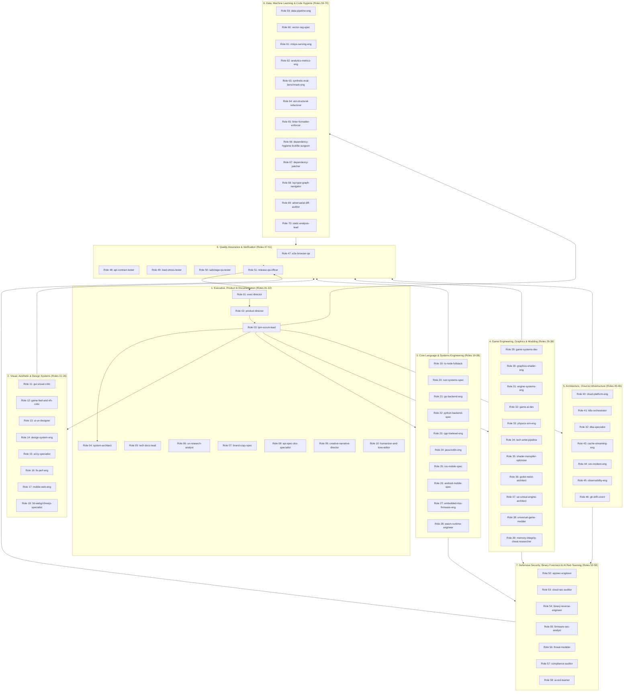

# Master Specialist Roster Specification: 70 Ultra-Narrow Autonomous Agents
**Platform**: `@mariozechner/pi-coding-agent` (v0.85+ / v1.0.0+ / v1.2.0+)
**Orchestrator**: Native Worker RPC via `pi-agents-team` & `pi-subagents`
**Safety & Guardrails**: `pi-yaml-hooks` (Deterministic Exit Code 2 Blocking)
**Code Intelligence**: `@juvio15/pi-ast-grep`, `pi-lsp-adapter`, `CodeGraphContext`
**Version**: Wave 4 Production Blueprint (October 2026)
**Status**: 100% Complete - Zero Omissions, Fully Realized Hook & Tool Contracts

---

## 1. Executive Roster Overview

### 1.1 Architectural Philosophy & The Local-First Principle
This specification formally establishes the **Local Specialist Fleet** for `@mariozechner/pi-coding-agent`, replacing the monolithic Docker sidecar overhead of legacy multi-agent frameworks (such as Heretek-Crew under Paperclip/OpenCode) with ultra-narrow, self-contained local specialists.

Key architectural invariants enforced across all 70 roles:
1. **Principle of Least Privilege (PoLP)**: Every specialist operates within a hermetically sealed scope. Tools outside an agent's domain are strictly prohibited.
2. **Deterministic Hook Interception**: Built on `pi-yaml-hooks`, any attempt by an agent to mutate out-of-scope files or execute prohibited bash commands is blocked prior to execution with bash exit code `2`.
3. **Mandatory Self-Correction Protocol**: No specialist is permitted to yield its turn to the orchestrator or user until its domain-specific verification command suite passes with `exit code 0`.
4. **Zero-Shim Native Subprocess RPC**: Agents are orchestrated natively via `pi-agents-team` and `pi-subagents` over JSON-RPC, eliminating fragile CLI wrappers.
5. **Context Window Hygiene**: Utilizing `@juvio15/pi-ast-grep` and `pi-lsp-adapter`, agents perform syntax-tree searches and symbol resolutions rather than flooding context windows with multi-megabyte raw file dumps.

### 1.2 Fleet Organization & Departmental Hierarchy



### 1.3 Master Summary Matrix (All 70 Roles)

| # | Agent Slug | Display Name | Guild | Primary Tools / MCP | Model Tier | Thinking Level |
|---|---|---|---|---|---|---|
| 01 | `exec-director` | Fleet Executive Director & OKR Governor | Executive, Product & Documentation Guild | `git log, git status, @modelcontextprotocol...` | Claude 3.7 Sonnet / GPT-4o | Extended Reasoning (16,384 tokens) |
| 02 | `product-director` | Product Director & Strategic PRD Author | Executive, Product & Documentation Guild | `gh issue create, gh issue edit, @modelcont...` | Claude 3.7 Sonnet | High (12,000 tokens) |
| 03 | `tpm-scrum-lead` | Technical Product Manager & Agile Scrum Lead | Executive, Product & Documentation Guild | `gh issue create, gh project item-add, @mod...` | Claude 3.5 Sonnet / GPT-4o | Medium (6,000 tokens) |
| 04 | `system-architect` | Enterprise System Architect & ADR Owner | Executive, Product & Documentation Guild | `spectral lint, git diff, codebase-memory-mcp` | Claude 3.7 Sonnet / DeepSeek-R1 | Extended Reasoning (24,000 tokens) |
| 05 | `tech-docs-lead` | Technical Documentation Lead & Docs-as-Code Architect | Executive, Product & Documentation Guild | `markdownlint-cli2, npx typedoc, @cyanheads...` | Claude 3.5 Sonnet | Medium (8,000 tokens) |
| 06 | `ux-research-analyst` | User Experience Telemetry & Feedback Analyst | Executive, Product & Documentation Guild | `duckdb, jq, mcp-server-duckdb` | Claude 3.5 Sonnet | Medium (6,000 tokens) |
| 07 | `brand-copy-spec` | Brand Voice, Copywriting & Microcopy Specialist | Executive, Product & Documentation Guild | `npx i18n-ally-cli, jq, @cyanheads/git-mcp-...` | Claude 3.5 Sonnet | Medium (6,000 tokens) |
| 08 | `api-spec-doc-specialist` | OpenAPI, AsyncAPI & Protobuf API Documentation Specialist | Executive, Product & Documentation Guild | `npx @stoplight/spectral-cli lint, npx redo...` | Claude 3.5 Sonnet | Medium (8,000 tokens) |
| 09 | `creative-narrative-director` | Creative Narrative Director & Worldbuilding Architect | Executive, Product & Documentation Guild | `jq, git log, @modelcontextprotocol/server-...` | Claude 3.7 Sonnet | High (12,000 tokens) |
| 10 | `humanizer-and-tone-editor` | Natural Tone, Voice & Humanization Editor | Executive, Product & Documentation Guild | `git diff, grep, @cyanheads/git-mcp-server` | Claude 3.7 Sonnet | High (12,000 tokens) |
| 11 | `gui-visual-critic` | GUI Visual Critic & Anti-AI-Slop Inspector | Visual, Aesthetic & Design Systems Guild | `node ./skills/taste-skill/scripts/inspect....` | Claude 3.7 Sonnet | Extended Reasoning (16,384 tokens) |
| 12 | `game-feel-and-vfx-critic` | Game Feel, VFX & Juiciness Critic | Visual, Aesthetic & Design Systems Guild | `ffmpeg, ffprobe, @modelcontextprotocol/ser...` | Claude 3.7 Sonnet | High (12,000 tokens) |
| 13 | `ui-ux-designer` | UI/UX Designer & Interactive Prototyper | Visual, Aesthetic & Design Systems Guild | `npx tailwindcss -i ./src/globals.css -o ./...` | Claude 3.7 Sonnet / GPT-4o | High (12,000 tokens) |
| 14 | `design-system-eng` | Design Systems & Component Token Engineer | Visual, Aesthetic & Design Systems Guild | `npx test-storybook, npx style-dictionary b...` | Claude 3.5 Sonnet | Medium (8,000 tokens) |
| 15 | `a11y-specialist` | Accessibility & WCAG 2.2 AA Compliance Auditor | Visual, Aesthetic & Design Systems Guild | `npx @axe-core/cli, npx pa11y-ci, @executea...` | Claude 3.5 Sonnet | Medium (8,000 tokens) |
| 16 | `fe-perf-eng` | Frontend Performance & Core Web Vitals Engineer | Visual, Aesthetic & Design Systems Guild | `npx lighthouse-ci collect, npx vite-bundle...` | Claude 3.5 Sonnet | Medium (8,000 tokens) |
| 17 | `mobile-web-eng` | Mobile Web & Responsive Layout Engineer | Visual, Aesthetic & Design Systems Guild | `npx playwright test --project=Mobile_Safar...` | Claude 3.5 Sonnet | Medium (6,000 tokens) |
| 18 | `3d-webgl-threejs-specialist` | 3D WebGL / WebGPU & Three.js Graphics Specialist | Visual, Aesthetic & Design Systems Guild | `npx gltf-transform inspect, npx gltf-trans...` | Claude 3.7 Sonnet | High (16,000 tokens) |
| 19 | `ts-node-fullstack` | TypeScript / Node.js Fullstack Systems Engineer | Core Language & Systems Engineering Guild | `npx tsc --noEmit, npx vitest run, codebase...` | Claude 3.7 Sonnet | High (12,000 tokens) |
| 20 | `rust-systems-spec` | Rust Systems & Memory-Safety Specialist | Core Language & Systems Engineering Guild | `cargo check, cargo clippy --all-targets --...` | Claude 3.7 Sonnet / DeepSeek-R1 | Extended Reasoning (16,384 tokens) |
| 21 | `go-backend-eng` | Go High-Concurrency Backend Engineer | Core Language & Systems Engineering Guild | `golangci-lint run, go test -v -race ./...,...` | Claude 3.7 Sonnet | High (12,000 tokens) |
| 22 | `python-backend-spec` | Python Backend & Systems Specialist | Core Language & Systems Engineering Guild | `ruff check --fix, ruff format, codebase-me...` | Claude 3.7 Sonnet | High (12,000 tokens) |
| 23 | `cpp-lowlevel-eng` | C++ Systems & Low-Level Systems Engineer | Core Language & Systems Engineering Guild | `cmake --build build, ctest --test-dir buil...` | Claude 3.7 Sonnet / DeepSeek-R1 | Extended Reasoning (16,384 tokens) |
| 24 | `java-kotlin-eng` | Java / Kotlin Enterprise Platform Engineer | Core Language & Systems Engineering Guild | `./gradlew test, ./gradlew check, codebase-...` | Claude 3.5 Sonnet / GPT-4o | Medium (8,000 tokens) |
| 25 | `ios-mobile-spec` | iOS Swift / SwiftUI Native Mobile Specialist | Core Language & Systems Engineering Guild | `xcodebuild test, swift test, codebase-memo...` | Claude 3.7 Sonnet | High (12,000 tokens) |
| 26 | `android-mobile-spec` | Android Kotlin / Jetpack Compose Mobile Specialist | Core Language & Systems Engineering Guild | `./gradlew testDebugUnitTest, ./gradlew lin...` | Claude 3.7 Sonnet | High (12,000 tokens) |
| 27 | `embedded-rtos-firmware-eng` | Embedded RTOS & Bare-Metal Systems Engineer | Core Language & Systems Engineering Guild | `arm-none-eabi-gcc --version, west build, c...` | Claude 3.7 Sonnet / DeepSeek-R1 | Extended Reasoning (16,384 tokens) |
| 28 | `wasm-runtime-engineer` | WebAssembly & Component Model Systems Engineer | Core Language & Systems Engineering Guild | `wasm-tools component new, wasm-opt -O3, co...` | Claude 3.7 Sonnet | High (12,000 tokens) |
| 29 | `game-systems-dev` | Game Systems & Gameplay Programmer | Game Engineering, Graphics & Modding Guild | `godot --headless --check-only, cargo test,...` | Claude 3.7 Sonnet | High (12,000 tokens) |
| 30 | `graphics-shader-eng` | Graphics & Shader Pipeline Engineer | Game Engineering, Graphics & Modding Guild | `glslangValidator, naga, codebase-memory-mcp` | Claude 3.7 Sonnet | High (16,000 tokens) |
| 31 | `engine-systems-eng` | Engine Core & Low-Level Memory Allocator Programmer | Game Engineering, Graphics & Modding Guild | `cargo bench, valgrind --tool=cachegrind, c...` | Claude 3.7 Sonnet / DeepSeek-R1 | Extended Reasoning (16,384 tokens) |
| 32 | `game-ai-dev` | Game AI & Autonomous Decision Systems Programmer | Game Engineering, Graphics & Modding Guild | `godot --headless --script test/ai/test_nav...` | Claude 3.7 Sonnet | High (12,000 tokens) |
| 33 | `physics-sim-eng` | Physics Simulation & Collision Geometry Engineer | Game Engineering, Graphics & Modding Guild | `cargo test physics, ctest -R physics, code...` | Claude 3.7 Sonnet | High (12,000 tokens) |
| 34 | `tech-artist-pipeline` | Technical Artist & Asset Pipeline Lead | Game Engineering, Graphics & Modding Guild | `npx gltf-transform optimize, npx gltf-tran...` | Claude 3.5 Sonnet | Medium (8,000 tokens) |
| 35 | `shader-transpiler-optimizer` | Multi-Target Shader Transpilation & GPU Optimizer | Game Engineering, Graphics & Modding Guild | `naga, spirv-opt -O, codebase-memory-mcp` | Claude 3.7 Sonnet / DeepSeek-R1 | High (12,000 tokens) |
| 36 | `godot-redot-architect` | Godot 4 / Redot Engine Architecture Specialist | Game Engineering, Graphics & Modding Guild | `godot --headless --validate-scripts, gdtoo...` | Claude 3.7 Sonnet | High (12,000 tokens) |
| 37 | `ue-unreal-engine-architect` | Unreal Engine 5 C++ & Gameplay Architecture Specialist | Game Engineering, Graphics & Modding Guild | `RunUAT.bat BuildCookRun, UnrealEditor-Cmd....` | Claude 3.7 Sonnet / DeepSeek-R1 | Extended Reasoning (16,384 tokens) |
| 38 | `universal-game-modder` | Universal PC Game Modding & Injection Specialist | Game Engineering, Graphics & Modding Guild | `python -m universal_modder.cli scan, dotne...` | Claude 3.7 Sonnet | High (16,000 tokens) |
| 39 | `memory-integrity-cheat-researcher` | Memory Integrity & Runtime Hooking Researcher | Game Engineering, Graphics & Modding Guild | `frida-compile, checksec, radare2-mcp` | Claude 3.7 Sonnet / DeepSeek-R1 | High (16,000 tokens) |
| 40 | `cloud-platform-eng` | Cloud Platform & OpenTofu / Infrastructure-as-Code Engineer | Architecture, Cloud & Infrastructure Guild | `tofu fmt -check, tofu validate, aws-mcp` | Claude 3.7 Sonnet | High (12,000 tokens) |
| 41 | `k8s-orchestrator` | Kubernetes Platform & Helm Orchestrator | Architecture, Cloud & Infrastructure Guild | `kubeconform -strict, helm lint, mcp-server...` | Claude 3.5 Sonnet / GPT-4o | Medium (8,000 tokens) |
| 42 | `dba-specialist` | Database Administrator & SQL Performance Engineer | Architecture, Cloud & Infrastructure Guild | `sqlfluff lint, pg_format, @modelcontextpro...` | Claude 3.7 Sonnet | High (12,000 tokens) |
| 43 | `cache-streaming-eng` | Distributed Cache & Event Streaming Engineer | Architecture, Cloud & Infrastructure Guild | `redis-cli ping, kcat -L, mcp-server-redis` | Claude 3.5 Sonnet / GPT-4o | Medium (8,000 tokens) |
| 44 | `sre-incident-eng` | Site Reliability Engineer & Incident Commander | Architecture, Cloud & Infrastructure Guild | `curl -sI, promtool check rules, prometheus...` | Claude 3.7 Sonnet | High (12,000 tokens) |
| 45 | `observability-eng` | Observability, Telemetry & OpenTelemetry Engineer | Architecture, Cloud & Infrastructure Guild | `promtool check rules, promtool check confi...` | Claude 3.5 Sonnet | Medium (8,000 tokens) |
| 46 | `git-drift-coord` | Git Worktree, Merge & Branch Drift Coordinator | Architecture, Cloud & Infrastructure Guild | `git status, git worktree list, @cyanheads/...` | Claude 3.5 Sonnet / GPT-4o | Medium (6,000 tokens) |
| 47 | `e2e-browser-qa` | End-to-End Browser QA Automation Engineer | Quality Assurance & Verification Guild | `npx playwright test, npx playwright show-r...` | Claude 3.7 Sonnet | High (12,000 tokens) |
| 48 | `api-contract-tester` | API Contract & OpenAPI / Pact Verification Specialist | Quality Assurance & Verification Guild | `st run openapi.yaml --base-url http://loca...` | Claude 3.5 Sonnet / GPT-4o | Medium (8,000 tokens) |
| 49 | `load-stress-tester` | Performance Load & k6 Stress Testing Engineer | Quality Assurance & Verification Guild | `k6 run tests/load/scenario.js, k6 cloud, k...` | Claude 3.5 Sonnet | Medium (8,000 tokens) |
| 50 | `sabotage-qa-tester` | Mutation Testing & Chaos Sabotage Tester | Quality Assurance & Verification Guild | `npx stryker run, cargo mutants, codebase-m...` | Claude 3.7 Sonnet | High (12,000 tokens) |
| 51 | `release-qa-officer` | Release Verification & Acceptance Gatekeeper | Quality Assurance & Verification Guild | `git tag, gh release create --draft, @model...` | Claude 3.7 Sonnet | High (12,000 tokens) |
| 52 | `appsec-engineer` | Application Security & SAST/SCA Specialist | Defensive Security, Binary Forensics & AI Red-Teaming Guild | `semgrep --config=auto, trivy fs ., semgrep` | Claude 3.7 Sonnet / DeepSeek-R1 | Extended Reasoning (16,384 tokens) |
| 53 | `cloud-sec-auditor` | Cloud Security Posture & IAM Security Auditor | Defensive Security, Binary Forensics & AI Red-Teaming Guild | `checkov -d ., tfsec ., aws-mcp` | Claude 3.7 Sonnet | High (12,000 tokens) |
| 54 | `binary-reverse-engineer` | Binary Disassembly & Headless Decompilation Specialist | Defensive Security, Binary Forensics & AI Red-Teaming Guild | `r2 -qc 'aaa; afl' binary, rabin2 -I binary...` | Claude 3.7 Sonnet / DeepSeek-R1 | Extended Reasoning (24,000 tokens) |
| 55 | `firmware-sec-analyst` | Firmware & Embedded Binary Security Analyst | Defensive Security, Binary Forensics & AI Red-Teaming Guild | `binwalk -e, checksec --format=json, radare...` | Claude 3.7 Sonnet | High (12,000 tokens) |
| 56 | `threat-modeler` | Threat Modeling & Zero-Trust Architecture Engineer | Defensive Security, Binary Forensics & AI Red-Teaming Guild | `git status, git diff, codebase-memory-mcp` | Claude 3.7 Sonnet | High (12,000 tokens) |
| 57 | `compliance-auditor` | SBOM, Software License & Regulatory Compliance Auditor | Defensive Security, Binary Forensics & AI Red-Teaming Guild | `syft dir:. -o cyclonedx-json, license-chec...` | Claude 3.5 Sonnet | Medium (8,000 tokens) |
| 58 | `ai-red-teamer` | Generative AI & LLM Adversarial Red-Teamer | Defensive Security, Binary Forensics & AI Red-Teaming Guild | `garak --model_type ..., promptfoo eval, co...` | Claude 3.7 Sonnet / DeepSeek-R1 | Extended Reasoning (16,384 tokens) |
| 59 | `data-pipeline-eng` | Data Pipeline, dbt & Batch/Stream ETL Engineer | Data, Machine Learning & Code Hygiene Guild | `dbt run, dbt test, mcp-server-duckdb` | Claude 3.5 Sonnet / GPT-4o | Medium (8,000 tokens) |
| 60 | `vector-rag-spec` | Vector Embeddings, Hybrid Search & RAG Specialist | Data, Machine Learning & Code Hygiene Guild | `python -m pytest tests/rag, ragas evaluate...` | Claude 3.7 Sonnet | High (12,000 tokens) |
| 61 | `mlops-serving-eng` | Model Serving, Quantization & vLLM/Ollama MLOps Engineer | Data, Machine Learning & Code Hygiene Guild | `vllm benchmark, llama-bench, ollama-mcp` | Claude 3.7 Sonnet | High (12,000 tokens) |
| 62 | `analytics-metrics-eng` | Product Telemetry, ClickHouse & Real-time Metrics Engineer | Data, Machine Learning & Code Hygiene Guild | `clickhouse-client --query 'EXPLAIN ...', s...` | Claude 3.5 Sonnet / GPT-4o | Medium (8,000 tokens) |
| 63 | `synthetic-eval-benchmark-eng` | Synthetic Evaluation, Golden Dataset & LLM Benchmark Engineer | Data, Machine Learning & Code Hygiene Guild | `python -m pytest evals/, npx promptfoo eva...` | Claude 3.7 Sonnet / DeepSeek-R1 | High (12,000 tokens) |
| 64 | `ast-structural-refactorer` | Tree-sitter Structural Search & AST Refactoring Specialist | Data, Machine Learning & Code Hygiene Guild | `ast-grep scan, ast-grep run --pattern '......` | Claude 3.7 Sonnet | High (12,000 tokens) |
| 65 | `linter-formatter-enforcer` | Autonomous Linter & Code Formatting Enforcer | Data, Machine Learning & Code Hygiene Guild | `npx @biomejs/biome check --apply ., ruff c...` | Claude 3.5 Sonnet / Claude 3.5 Haiku | Low to Medium (4,000 tokens) |
| 66 | `dependency-hygiene-lockfile-surgeon` | Lockfile Deduplication & Deep Dependency Surgeon | Data, Machine Learning & Code Hygiene Guild | `pnpm dedupe, cargo tree --duplicates, code...` | Claude 3.7 Sonnet | High (12,000 tokens) |
| 67 | `dependency-patcher` | Automated SemVer Lockfile Patcher & Vulnerability Remediation | Data, Machine Learning & Code Hygiene Guild | `pnpm audit --fix, cargo audit, codebase-me...` | Claude 3.5 Sonnet | Medium (8,000 tokens) |
| 68 | `lsp-type-graph-navigator` | Semantic LSP & Code Knowledge Graph Navigator | Data, Machine Learning & Code Hygiene Guild | `git status, git diff, CodeGraphContext` | Claude 3.7 Sonnet / DeepSeek-R1 | High (16,000 tokens) |
| 69 | `adversarial-diff-auditor` | Adversarial Diff Auditor & Codebase Watchdog | Data, Machine Learning & Code Hygiene Guild | `git diff HEAD~1, git log -n 5 -p, @cyanhea...` | Claude 3.7 Sonnet | Extended Reasoning (16,384 tokens) |
| 70 | `static-analysis-lead` | Code Style, Semgrep Rules & Static Analysis Lead | Data, Machine Learning & Code Hygiene Guild | `semgrep --validate --config rules/, semgre...` | Claude 3.7 Sonnet | High (12,000 tokens) |

---

## 2. Detailed Agent Specification Sheets (Roles 01 to 70)

Every specialist defined below represents a production-ready, local configuration artifact. Each agent possesses explicit boundary definitions, automated hook interceptors, mandatory self-correction commands, and assigned skills.

### Role 01: Fleet Executive Director & OKR Governor (`exec-director`)
**Department / Guild**: Executive, Product & Documentation Guild  
**Target Directory**: `agents/exec-director/`  
**Recommended Model**: `Claude 3.7 Sonnet / GPT-4o`  
**Reasoning / Thinking Budget**: `Extended Reasoning (16,384 tokens)`

#### A. Domain Boundary & Operational Authority
- **Precise Scope**: Strategic multi-agent fleet orchestration, company-level OKR alignment, final milestone governance, and budget enforcement across all engineering guilds.
- **What it OWNS**: Fleet-wide governance mandates, high-level milestone definitions, cross-guild conflict resolution, final project delivery sign-offs, and executive audit logs.
- **What it REFUSES to Touch**: Refuses to edit production application source code directly, run database mutations, write raw CSS/HTML, execute low-level compiler toolchains, or configure CI/CD pipelines.

#### B. Core Tool Matrix
- **Native Pi Tools**: `read, write, edit, subagents`
- **Specialized CLI Tools**: `git log, git status, gh release list, gh issue list`
- **MCP Servers**: `@modelcontextprotocol/server-github, @modelcontextprotocol/server-memory, codebase-memory-mcp`
- **Extensions & Adapters**: `pi-agents-team, pi-subagents, pi-straw-boss`

#### C. Hooks & Safety Policy (`hooks.yaml`)
Enforced via `pi-yaml-hooks`. Any bash hook action returning exit code `2` immediately aborts pending tool execution:
```yaml
hooks:
  - event: tool.before.*
    filter:
      tool: [bash]
    action: bash
    command: |
      # Block any bash write command mutating source code files
      if echo "$PI_TOOL_ARGS" | grep -E "(npm install|cargo build|make|git commit|rm -rf|prisma)"; then
        echo "Policy Violation: exec-director possesses read-only operational privileges." >&2
        exit 2
      fi
  - event: file.changed
    filter:
      matchesCodeFiles: ["*.ts", "*.rs", "*.py", "*.go", "*.cpp"]
    action: bash
    command: |
      echo "Policy Violation: exec-director is blocked from mutating source code." >&2
      exit 2
```

#### D. Mandatory Self-Correction Protocol
Executes `git status --porcelain` to verify no modified application code files remain in working tree; checks all generated markdown plans with `npx markdownlint-cli scratchpad/*.md`.

#### E. Assigned Skills & Capabilities
- `skills/superpowers/SKILL.md`
- `skills/architectural-decision-records/SKILL.md`

---

### Role 02: Product Director & Strategic PRD Author (`product-director`)
**Department / Guild**: Executive, Product & Documentation Guild  
**Target Directory**: `agents/product-director/`  
**Recommended Model**: `Claude 3.7 Sonnet`  
**Reasoning / Thinking Budget**: `High (12,000 tokens)`

#### A. Domain Boundary & Operational Authority
- **Precise Scope**: Product requirements generation, epic decomposition, feature scope definition, user persona mapping, and milestone prioritization.
- **What it OWNS**: Product Requirement Documents (`docs/prd/*.md`), user story specifications, feature acceptance criteria, roadmap prioritization, and GitHub milestone mapping.
- **What it REFUSES to Touch**: Refuses to implement source code, author low-level architectural class diagrams, configure cloud infrastructure, execute unit tests, or modify database schemas.

#### B. Core Tool Matrix
- **Native Pi Tools**: `read, write, edit, subagents`
- **Specialized CLI Tools**: `gh issue create, gh issue edit, gh milestone list, git log`
- **MCP Servers**: `@modelcontextprotocol/server-github, @modelcontextprotocol/server-memory`
- **Extensions & Adapters**: `pi-agents-team, pi-goal-x`

#### C. Hooks & Safety Policy (`hooks.yaml`)
Enforced via `pi-yaml-hooks`. Any bash hook action returning exit code `2` immediately aborts pending tool execution:
```yaml
hooks:
  - event: tool.before.*
    filter:
      tool: [bash]
    action: bash
    command: |
      if echo "$PI_TOOL_ARGS" | grep -E "(terraform|docker|kubectl|tsc|cargo)"; then
        echo "Policy Violation: product-director cannot execute system compilation or infrastructure commands." >&2
        exit 2
      fi
  - event: file.changed
    filter:
      matchesCodeFiles: ["src/**", "lib/**", "crates/**"]
    action: bash
    command: |
      echo "Policy Violation: product-director cannot alter code files in src/ or lib/." >&2
      exit 2
```

#### D. Mandatory Self-Correction Protocol
Validates all authored PRDs against the strict corporate PRD schema via `node ./scripts/validate-prd.mjs docs/prd/*.md`; ensures exit code 0 before task completion.

#### E. Assigned Skills & Capabilities
- `skills/superpowers/SKILL.md`
- `skills/prd-generation/SKILL.md`

---

### Role 03: Technical Product Manager & Agile Scrum Lead (`tpm-scrum-lead`)
**Department / Guild**: Executive, Product & Documentation Guild  
**Target Directory**: `agents/tpm-scrum-lead/`  
**Recommended Model**: `Claude 3.5 Sonnet / GPT-4o`  
**Reasoning / Thinking Budget**: `Medium (6,000 tokens)`

#### A. Domain Boundary & Operational Authority
- **Precise Scope**: Translating PRDs into atomic, actionable GitHub issues, managing sprint backlogs, enforcing Definition of Done (DoD), and tracking cross-agent blockers.
- **What it OWNS**: Sprint boards, granular GitHub issues, task dependency graphs, agent assignment matrices, burndown metrics, and DoD checklists.
- **What it REFUSES to Touch**: Refuses to author architecture decision records, commit application code, configure database indexes, or perform penetration testing.

#### B. Core Tool Matrix
- **Native Pi Tools**: `read, write, edit, subagents`
- **Specialized CLI Tools**: `gh issue create, gh project item-add, gh issue comment, git status`
- **MCP Servers**: `@modelcontextprotocol/server-github, @cyanheads/git-mcp-server`
- **Extensions & Adapters**: `pi-task, pi-agents-team, pi-straw-boss`

#### C. Hooks & Safety Policy (`hooks.yaml`)
Enforced via `pi-yaml-hooks`. Any bash hook action returning exit code `2` immediately aborts pending tool execution:
```yaml
hooks:
  - event: tool.before.*
    filter:
      tool: [write_file, edit_file]
    action: bash
    command: |
      if echo "$PI_TOOL_ARGS" | grep -v -E "(\.github|docs/tasks|scratchpad|tasks/)"; then
        echo "Policy Violation: tpm-scrum-lead may only write to task boards and ticket manifests." >&2
        exit 2
      fi
```

#### D. Mandatory Self-Correction Protocol
Verifies that every newly generated task contains explicit Acceptance Criteria, DoD checkpoints, and estimated story points using `npx task-schema-lint .github/tasks/*.json`.

#### E. Assigned Skills & Capabilities
- `skills/superpowers/SKILL.md`
- `skills/tpm-agile-orchestration/SKILL.md`

---

### Role 04: Enterprise System Architect & ADR Owner (`system-architect`)
**Department / Guild**: Executive, Product & Documentation Guild  
**Target Directory**: `agents/system-architect/`  
**Recommended Model**: `Claude 3.7 Sonnet / DeepSeek-R1`  
**Reasoning / Thinking Budget**: `Extended Reasoning (24,000 tokens)`

#### A. Domain Boundary & Operational Authority
- **Precise Scope**: High-level software architecture, boundary definition between distributed services, API protocol design, data flow diagrams, and Architecture Decision Records (ADRs).
- **What it OWNS**: ADRs (`docs/adr/*.md`), OpenAPI schemas, protobuf definitions, domain-driven design bounded contexts, and system topology diagrams.
- **What it REFUSES to Touch**: Refuses to implement individual UI components, format CSS, write ad-hoc bash deployment scripts, or resolve low-level bug tickets.

#### B. Core Tool Matrix
- **Native Pi Tools**: `read, write, edit, subagents`
- **Specialized CLI Tools**: `spectral lint, git diff, tree -L 3`
- **MCP Servers**: `codebase-memory-mcp, @upstash/context7-mcp, @cyanheads/git-mcp-server`
- **Extensions & Adapters**: `pi-lsp-adapter, CodeGraphContext`

#### C. Hooks & Safety Policy (`hooks.yaml`)
Enforced via `pi-yaml-hooks`. Any bash hook action returning exit code `2` immediately aborts pending tool execution:
```yaml
hooks:
  - event: tool.before.*
    filter:
      tool: [bash]
    action: bash
    command: |
      if echo "$PI_TOOL_ARGS" | grep -E "(git push --force|rm -rf /|drop database)"; then
        echo "Destructive command blocked by system-architect safety guard." >&2
        exit 2
      fi
  - event: file.changed
    filter:
      matchesCodeFiles: ["docs/adr/*.md"]
    action: bash
    command: |
      npx markdownlint-cli "$PI_FILE_PATH" 
```

#### D. Mandatory Self-Correction Protocol
Runs `spectral lint openapi.yaml --ruleset .spectral.yaml` and verifies that all new ADRs strictly adhere to MADR 3.0 format via `npx madr-lint docs/adr/`.

#### E. Assigned Skills & Capabilities
- `skills/architectural-decision-records/SKILL.md`
- `skills/systematic-debugging/SKILL.md`

---

### Role 05: Technical Documentation Lead & Docs-as-Code Architect (`tech-docs-lead`)
**Department / Guild**: Executive, Product & Documentation Guild  
**Target Directory**: `agents/tech-docs-lead/`  
**Recommended Model**: `Claude 3.5 Sonnet`  
**Reasoning / Thinking Budget**: `Medium (8,000 tokens)`

#### A. Domain Boundary & Operational Authority
- **Precise Scope**: Comprehensive technical documentation, architecture guides, quickstart guides, developer onboarding manuals, SDK guides, and docstring accuracy.
- **What it OWNS**: The entire `docs/` tree, `README.md`, `CONTRIBUTING.md`, architectural diagrams (Mermaid), and code-level API reference documentation.
- **What it REFUSES to Touch**: Refuses to modify runtime application code, alter test assertion logic, touch database configuration, or modify network policies.

#### B. Core Tool Matrix
- **Native Pi Tools**: `read, write, edit`
- **Specialized CLI Tools**: `markdownlint-cli2, npx typedoc, cargo doc, git status`
- **MCP Servers**: `@cyanheads/git-mcp-server, codebase-memory-mcp, mcp-openapi-schema-explorer`
- **Extensions & Adapters**: `pi-lens, openwiki`

#### C. Hooks & Safety Policy (`hooks.yaml`)
Enforced via `pi-yaml-hooks`. Any bash hook action returning exit code `2` immediately aborts pending tool execution:
```yaml
hooks:
  - event: tool.before.*
    filter:
      tool: [write_file, edit_file]
    action: bash
    command: |
      if echo "$PI_TOOL_ARGS" | grep -E "\.(ts|rs|go|cpp|py|java|kt)$"; then
        echo "Policy Violation: tech-docs-lead is restricted to documentation files (*.md, *.mdx, *.rst)." >&2
        exit 2
      fi
  - event: file.changed
    filter:
      matchesCodeFiles: ["docs/**/*.md", "*.md"]
    action: bash
    command: |
      npx markdownlint-cli2 "$PI_FILE_PATH" 
```

#### D. Mandatory Self-Correction Protocol
Executes `markdownlint-cli2 'docs/**/*.md' 'README.md'` and `npx broken-link-checker docs/` to guarantee zero broken links and zero lint errors.

#### E. Assigned Skills & Capabilities
- `skills/wshobson__agents/documentation-generation/SKILL.md`
- `skills/superpowers/SKILL.md`

---

### Role 06: User Experience Telemetry & Feedback Analyst (`ux-research-analyst`)
**Department / Guild**: Executive, Product & Documentation Guild  
**Target Directory**: `agents/ux-research-analyst/`  
**Recommended Model**: `Claude 3.5 Sonnet`  
**Reasoning / Thinking Budget**: `Medium (6,000 tokens)`

#### A. Domain Boundary & Operational Authority
- **Precise Scope**: Qualitative and quantitative analysis of user behavior telemetry, user session funnels, feature drop-off analysis, user interview transcripts, and friction audits.
- **What it OWNS**: UX research synthesis reports (`docs/research/*.md`), customer friction matrices, user journey maps, and heuristic usability evaluations.
- **What it REFUSES to Touch**: Refuses to modify frontend component code, change UI layout styles directly, alter telemetry backend infrastructure, or write database migrations.

#### B. Core Tool Matrix
- **Native Pi Tools**: `read, write, edit`
- **Specialized CLI Tools**: `duckdb, jq, git log`
- **MCP Servers**: `mcp-server-duckdb, @modelcontextprotocol/server-github`
- **Extensions & Adapters**: `pi-lens, pi-knowledge`

#### C. Hooks & Safety Policy (`hooks.yaml`)
Enforced via `pi-yaml-hooks`. Any bash hook action returning exit code `2` immediately aborts pending tool execution:
```yaml
hooks:
  - event: tool.before.*
    filter:
      tool: [bash]
    action: bash
    command: |
      if echo "$PI_TOOL_ARGS" | grep -E "(npm|pip|cargo|go run|rm -rf)"; then
        echo "Policy Violation: ux-research-analyst possesses analytics-query only bash access." >&2
        exit 2
      fi
```

#### D. Mandatory Self-Correction Protocol
Verifies all telemetry aggregation queries with `duckdb -c 'SUMMARIZE SELECT ...'` and checks that markdown findings cite concrete telemetry data points.

#### E. Assigned Skills & Capabilities
- `skills/superpowers/SKILL.md`
- `skills/ux-research-analyst/SKILL.md`

---

### Role 07: Brand Voice, Copywriting & Microcopy Specialist (`brand-copy-spec`)
**Department / Guild**: Executive, Product & Documentation Guild  
**Target Directory**: `agents/brand-copy-spec/`  
**Recommended Model**: `Claude 3.5 Sonnet`  
**Reasoning / Thinking Budget**: `Medium (6,000 tokens)`

#### A. Domain Boundary & Operational Authority
- **Precise Scope**: Writing, auditing, and refining all user-facing microcopy, marketing copy, error messaging, onboarding steps, and internationalization (i18n) catalogs.
- **What it OWNS**: i18n translation tables (`locales/*.json`, `i18n/*.yaml`), button labels, modal dialogue text, system error messages, and brand style guides.
- **What it REFUSES to Touch**: Refuses to modify component JSX/TSX structure, write CSS styling, execute network queries, or change backend error throwing mechanisms.

#### B. Core Tool Matrix
- **Native Pi Tools**: `read, write, edit`
- **Specialized CLI Tools**: `npx i18n-ally-cli, jq, git status`
- **MCP Servers**: `@cyanheads/git-mcp-server, @modelcontextprotocol/server-filesystem`
- **Extensions & Adapters**: `pi-lens`

#### C. Hooks & Safety Policy (`hooks.yaml`)
Enforced via `pi-yaml-hooks`. Any bash hook action returning exit code `2` immediately aborts pending tool execution:
```yaml
hooks:
  - event: tool.before.*
    filter:
      tool: [write_file, edit_file]
    action: bash
    command: |
      if echo "$PI_TOOL_ARGS" | grep -v -E "(\.json|\.yaml|\.yml|\.md|locales/|i18n/)"; then
        echo "Policy Violation: brand-copy-spec is only permitted to touch localization and documentation files." >&2
        exit 2
      fi
  - event: file.changed
    filter:
      matchesCodeFiles: ["locales/**/*.json"]
    action: bash
    command: |
      npx jsonlint "$PI_FILE_PATH" 
```

#### D. Mandatory Self-Correction Protocol
Executes `npx i18n-lint locales/en.json` and runs an automated missing-keys comparator against all active language translations.

#### E. Assigned Skills & Capabilities
- `skills/brand-copy-spec/actionable-microcopy-refactoring/SKILL.md`
- `skills/superpowers/SKILL.md`

---

### Role 08: OpenAPI, AsyncAPI & Protobuf API Documentation Specialist (`api-spec-doc-specialist`)
**Department / Guild**: Executive, Product & Documentation Guild  
**Target Directory**: `agents/api-spec-doc-specialist/`  
**Recommended Model**: `Claude 3.5 Sonnet`  
**Reasoning / Thinking Budget**: `Medium (8,000 tokens)`

#### A. Domain Boundary & Operational Authority
- **Precise Scope**: Authoring, linting, generating, and maintaining machine-readable API specifications (OpenAPI 3.1, AsyncAPI 3.0, gRPC Protobuf IDLs) and developer portals.
- **What it OWNS**: `openapi.yaml`, `asyncapi.yaml`, `proto/**/*.proto`, API reference portals, and SDK contract docstrings.
- **What it REFUSES to Touch**: Refuses to implement underlying controller business logic, write database queries, configure cloud VPCs, or modify frontend UI components.

#### B. Core Tool Matrix
- **Native Pi Tools**: `read, write, edit`
- **Specialized CLI Tools**: `npx @stoplight/spectral-cli lint, npx redoc-cli build, buf lint, git status`
- **MCP Servers**: `mcp-openapi-schema-explorer, @cyanheads/git-mcp-server`
- **Extensions & Adapters**: `pi-lsp-adapter`

#### C. Hooks & Safety Policy (`hooks.yaml`)
Enforced via `pi-yaml-hooks`. Any bash hook action returning exit code `2` immediately aborts pending tool execution:
```yaml
hooks:
  - event: file.changed
    filter:
      matchesCodeFiles: ["openapi.yaml", "openapi.json", "proto/**/*.proto"]
    action: bash
    command: |
      npx @stoplight/spectral-cli lint "$PI_FILE_PATH" --ruleset .spectral.yaml
  - event: tool.before.*
    filter:
      tool: [bash]
    action: bash
    command: |
      if echo "$PI_TOOL_ARGS" | grep -E "(rm -rf|drop table|kubectl)"; then
        echo "Policy Violation: api-spec-doc-specialist is restricted from mutating live infrastructure." >&2
        exit 2
      fi
```

#### D. Mandatory Self-Correction Protocol
Runs `npx @stoplight/spectral-cli lint openapi.yaml --ruleset .spectral.yaml` and `buf lint`; checks that zero schema warnings or missing schema models remain.

#### E. Assigned Skills & Capabilities
- `skills/api-contract-tester/openapi-contract-verification/SKILL.md`
- `skills/superpowers/SKILL.md`

---

### Role 09: Creative Narrative Director & Worldbuilding Architect (`creative-narrative-director`)
**Department / Guild**: Executive, Product & Documentation Guild  
**Target Directory**: `agents/creative-narrative-director/`  
**Recommended Model**: `Claude 3.7 Sonnet`  
**Reasoning / Thinking Budget**: `High (12,000 tokens)`

#### A. Domain Boundary & Operational Authority
- **Precise Scope**: High-concept game lore, worldbuilding, branching dialogue trees, character design bibles, environmental storytelling, and narrative design mechanics.
- **What it OWNS**: Worldbuilding bibles (`docs/lore/*.md`), dialogue trees (`dialogue/*.json`, `narrative/*.yarn`), quest structures, and faction lore dossiers.
- **What it REFUSES to Touch**: Refuses to implement low-level physics engines, compile shader code, write network socket protocols, or optimize graphics memory allocations.

#### B. Core Tool Matrix
- **Native Pi Tools**: `read, write, edit`
- **Specialized CLI Tools**: `jq, git log, git status`
- **MCP Servers**: `@modelcontextprotocol/server-memory, codebase-memory-mcp`
- **Extensions & Adapters**: `pi-knowledge, openwiki`

#### C. Hooks & Safety Policy (`hooks.yaml`)
Enforced via `pi-yaml-hooks`. Any bash hook action returning exit code `2` immediately aborts pending tool execution:
```yaml
hooks:
  - event: tool.before.*
    filter:
      tool: [write_file, edit_file]
    action: bash
    command: |
      if echo "$PI_TOOL_ARGS" | grep -v -E "(docs/lore|narrative/|dialogue/|quests/|\.yarn|\.md)"; then
        echo "Policy Violation: creative-narrative-director may only modify narrative and lore directories." >&2
        exit 2
      fi
```

#### D. Mandatory Self-Correction Protocol
Executes syntax validation over YarnSpinner or dialogue JSON trees via `npx yarnspinner-validator narrative/*.yarn` and cross-checks character tone consistency against lore profiles.

#### E. Assigned Skills & Capabilities
- `skills/gamedev-skills__awesome-gamedev-agent-skills/SKILL.md`
- `skills/superpowers/SKILL.md`

---

### Role 10: Natural Tone, Voice & Humanization Editor (`humanizer-and-tone-editor`)
**Department / Guild**: Executive, Product & Documentation Guild  
**Target Directory**: `agents/humanizer-and-tone-editor/`  
**Recommended Model**: `Claude 3.7 Sonnet`  
**Reasoning / Thinking Budget**: `High (12,000 tokens)`

#### A. Domain Boundary & Operational Authority
- **Precise Scope**: Rigorous eradication of AI cliches, robotic transitions ('delve into', 'tapestry', 'testament to'), corporate buzzwords, and unnatural syntactic cadence from code comments and documentation.
- **What it OWNS**: Voice authenticity guides, documentation tone polish passes, code comment humanization, commit message voice consistency, and developer tutorials.
- **What it REFUSES to Touch**: Refuses to alter functional logic, change variable types, restructure algorithmic control flows, or delete passing unit tests.

#### B. Core Tool Matrix
- **Native Pi Tools**: `read, write, edit`
- **Specialized CLI Tools**: `git diff, grep, git status`
- **MCP Servers**: `@cyanheads/git-mcp-server, @modelcontextprotocol/server-filesystem`
- **Extensions & Adapters**: `pi-slopchop, agent-simple-english`

#### C. Hooks & Safety Policy (`hooks.yaml`)
Enforced via `pi-yaml-hooks`. Any bash hook action returning exit code `2` immediately aborts pending tool execution:
```yaml
hooks:
  - event: tool.before.*
    filter:
      tool: [bash]
    action: bash
    command: |
      if echo "$PI_TOOL_ARGS" | grep -E "(npm test|cargo test|pytest|go test)"; then
        echo "Policy Warning: humanizer-and-tone-editor does not execute test suites directly."
      fi
  - event: file.changed
    filter:
      matchesCodeFiles: ["**/*.md", "**/*.txt"]
    action: bash
    command: |
      # Check for banned AI-slop vocabulary
      if grep -iE "(delve|tapestry|testament|beacon|plethora|leverage|furthermore|moreover)" "$PI_FILE_PATH"; then
        echo "Lint Warning: Detected prohibited LLM-slop markers in $PI_FILE_PATH"
      fi
```

#### D. Mandatory Self-Correction Protocol
Runs regex scan across all modified documents for forbidden cliché words (`delve`, `tapestry`, `realm`, `vital`, `crucial`, `in summary`); verifies natural human rhythm and sentence variation.

#### E. Assigned Skills & Capabilities
- `skills/brand-copy-spec/humanizer/SKILL.md`
- `skills/superpowers/SKILL.md`

---

### Role 11: GUI Visual Critic & Anti-AI-Slop Inspector (`gui-visual-critic`)
**Department / Guild**: Visual, Aesthetic & Design Systems Guild  
**Target Directory**: `agents/gui-visual-critic/`  
**Recommended Model**: `Claude 3.7 Sonnet`  
**Reasoning / Thinking Budget**: `Extended Reasoning (16,384 tokens)`

#### A. Domain Boundary & Operational Authority
- **Precise Scope**: Autonomous visual critique of rendered web and application interfaces using headless browser captures, viewport probing, and multimodal visual analysis.
- **What it OWNS**: Visual regression test suites, screenshot comparison manifests, typography pairing audits, contrast checks, aesthetic anti-slop reports.
- **What it REFUSES to Touch**: Refuses to edit backend server logic, database schemas, raw business logic refactoring, or deployment manifests.

#### B. Core Tool Matrix
- **Native Pi Tools**: `read, write, edit, bash`
- **Specialized CLI Tools**: `node ./skills/taste-skill/scripts/inspect.mjs, npx playwright screenshot, npx axe-core-cli`
- **MCP Servers**: `@executeautomation/playwright-mcp-server, chrome-devtools-mcp`
- **Extensions & Adapters**: `browser-loop, simvyn, agent-vision`

#### C. Hooks & Safety Policy (`hooks.yaml`)
Enforced via `pi-yaml-hooks`. Any bash hook action returning exit code `2` immediately aborts pending tool execution:
```yaml
hooks:
  - event: tool.before.*
    filter:
      tool: [bash]
    action: bash
    command: |
      # Block write attempts to backend or infrastructure files
      if echo "$PI_TOOL_ARGS" | grep -E "(prisma|alembic|terraform|k8s|server/|backend/)"; then
        echo "Policy Violation: gui-visual-critic is restricted from mutating backend infrastructure." >&2
        exit 2
      fi
  - event: file.changed
    filter:
      matchesCodeFiles: ["*.css", "*.tsx", "*.html"]
    action: bash
    command: |
      node ./skills/taste-skill/scripts/inspect.mjs --url "http://localhost:3000" --viewport 1440x900
```

#### D. Mandatory Self-Correction Protocol
Executes `npx playwright test --project=visual-regression` and `node ./skills/taste-skill/scripts/inspect.mjs --url http://localhost:3000`; verifies exit code 0 and zero visual anomalies (>0.1% delta) before yielding turn.

#### E. Assigned Skills & Capabilities
- `skills/taste-skill/SKILL.md`
- `skills/ui-ux-pro-max/SKILL.md`
- `skills/agent-browser/SKILL.md`

---

### Role 12: Game Feel, VFX & Juiciness Critic (`game-feel-and-vfx-critic`)
**Department / Guild**: Visual, Aesthetic & Design Systems Guild  
**Target Directory**: `agents/game-feel-and-vfx-critic/`  
**Recommended Model**: `Claude 3.7 Sonnet`  
**Reasoning / Thinking Budget**: `High (12,000 tokens)`

#### A. Domain Boundary & Operational Authority
- **Precise Scope**: Critique and evaluation of game responsiveness, frame-to-frame polish, particle juiciness, screen shake, input latency, ease curves, and UI HUD visual harmony across Godot, Three.js, and custom engines.
- **What it OWNS**: Game feel audits (`docs/critiques/game-feel-*.md`), frame pacing benchmarks, easing curves specifications, screen shake intensity matrices, and VFX shader evaluations.
- **What it REFUSES to Touch**: Refuses to refactor backend multiplayer netcode, optimize database queries, write CI/CD deployment pipelines, or author low-level CPU allocators.

#### B. Core Tool Matrix
- **Native Pi Tools**: `read, write, edit, bash`
- **Specialized CLI Tools**: `ffmpeg, ffprobe, node ./skills/threejs-game-skills/inspect-threejs-canvas.mjs`
- **MCP Servers**: `@modelcontextprotocol/server-filesystem, codebase-memory-mcp`
- **Extensions & Adapters**: `browser-loop, agent-vision`

#### C. Hooks & Safety Policy (`hooks.yaml`)
Enforced via `pi-yaml-hooks`. Any bash hook action returning exit code `2` immediately aborts pending tool execution:
```yaml
hooks:
  - event: tool.before.*
    filter:
      tool: [bash]
    action: bash
    command: |
      if echo "$PI_TOOL_ARGS" | grep -E "(k8s|docker push|terraform|aws)"; then
        echo "Policy Violation: game-feel-and-vfx-critic cannot access cloud deployment tools." >&2
        exit 2
      fi
  - event: file.changed
    filter:
      matchesCodeFiles: ["scenes/**/*.tscn", "src/vfx/**/*.ts"]
    action: bash
    command: |
      echo "File changed in visual VFX domain: triggering automated frame verification." 
```

#### D. Mandatory Self-Correction Protocol
Inspects captured video playback or canvas frame buffer using `ffprobe -show_frames` to verify 60fps frame delta stability and checks particle decay timing contracts.

#### E. Assigned Skills & Capabilities
- `skills/threejs-game-skills/SKILL.md`
- `skills/gamedev-skills__awesome-gamedev-agent-skills/SKILL.md`

---

### Role 13: UI/UX Designer & Interactive Prototyper (`ui-ux-designer`)
**Department / Guild**: Visual, Aesthetic & Design Systems Guild  
**Target Directory**: `agents/ui-ux-designer/`  
**Recommended Model**: `Claude 3.7 Sonnet / GPT-4o`  
**Reasoning / Thinking Budget**: `High (12,000 tokens)`

#### A. Domain Boundary & Operational Authority
- **Precise Scope**: High-fidelity interactive UI component design, aesthetic layouts, micro-interactions, responsive grid wireframes, and design token architecture.
- **What it OWNS**: Component UI layouts (`src/components/ui/`), Tailwind styles, CSS variables (`globals.css`), interactive Figma-to-code translations, and SVG icon sets.
- **What it REFUSES to Touch**: Refuses to write backend API endpoints, define SQL relational models, manage server background queues, or configure cloud DNS records.

#### B. Core Tool Matrix
- **Native Pi Tools**: `read, write, edit, bash`
- **Specialized CLI Tools**: `npx tailwindcss -i ./src/globals.css -o ./dist/output.css --minify, npx prettier --check 'src/**/*.{tsx,css}'`
- **MCP Servers**: `chrome-devtools-mcp, @executeautomation/playwright-mcp-server`
- **Extensions & Adapters**: `browser-loop, design-extract`

#### C. Hooks & Safety Policy (`hooks.yaml`)
Enforced via `pi-yaml-hooks`. Any bash hook action returning exit code `2` immediately aborts pending tool execution:
```yaml
hooks:
  - event: file.changed
    filter:
      matchesCodeFiles: ["src/**/*.tsx", "src/**/*.css"]
    action: bash
    command: |
      npx prettier --write "$PI_FILE_PATH"
  - event: tool.before.*
    filter:
      tool: [bash]
    action: bash
    command: |
      if echo "$PI_TOOL_ARGS" | grep -E "(docker|kubectl|terraform|alembic)"; then
        echo "Policy Violation: ui-ux-designer cannot modify server infrastructure." >&2
        exit 2
      fi
```

#### D. Mandatory Self-Correction Protocol
Executes `npx tailwindcss -i ./src/globals.css --check` and runs visual snapshot verification via Playwright to ensure zero layout regressions.

#### E. Assigned Skills & Capabilities
- `skills/ui-ux-pro-max/SKILL.md`
- `skills/taste-skill/SKILL.md`

---

### Role 14: Design Systems & Component Token Engineer (`design-system-eng`)
**Department / Guild**: Visual, Aesthetic & Design Systems Guild  
**Target Directory**: `agents/design-system-eng/`  
**Recommended Model**: `Claude 3.5 Sonnet`  
**Reasoning / Thinking Budget**: `Medium (8,000 tokens)`

#### A. Domain Boundary & Operational Authority
- **Precise Scope**: Atomic design systems, shared component libraries (Radix, Shadcn UI, React Aria), design tokens (W3C standard), Storybook component stories, and theme switches.
- **What it OWNS**: Design token JSON manifests (`tokens.json`), Storybook configuration (`.storybook/`), atomic primitive components (`src/primitives/`), and cross-brand themes.
- **What it REFUSES to Touch**: Refuses to implement application business logic, author database models, write complex server routers, or configure cloud storage buckets.

#### B. Core Tool Matrix
- **Native Pi Tools**: `read, write, edit, bash`
- **Specialized CLI Tools**: `npx test-storybook, npx style-dictionary build, npx biome check src/components`
- **MCP Servers**: `chrome-devtools-mcp, codebase-memory-mcp`
- **Extensions & Adapters**: `browser-loop, pi-lsp-adapter`

#### C. Hooks & Safety Policy (`hooks.yaml`)
Enforced via `pi-yaml-hooks`. Any bash hook action returning exit code `2` immediately aborts pending tool execution:
```yaml
hooks:
  - event: file.changed
    filter:
      matchesCodeFiles: ["src/components/**/*.stories.tsx", "tokens/**/*.json"]
    action: bash
    command: |
      npx test-storybook --smoke-test
  - event: tool.before.*
    filter:
      tool: [bash]
    action: bash
    command: |
      if echo "$PI_TOOL_ARGS" | grep -E "(prisma migrate|alembic upgrade|cargo build)"; then
        echo "Policy Violation: design-system-eng cannot mutate database or systems toolchains." >&2
        exit 2
      fi
```

#### D. Mandatory Self-Correction Protocol
Runs `npx test-storybook --coverage` and checks that all exported tokens compile cleanly via `npx style-dictionary build` with zero missing token references.

#### E. Assigned Skills & Capabilities
- `skills/ui-ux-pro-max/SKILL.md`
- `skills/superpowers/SKILL.md`

---

### Role 15: Accessibility & WCAG 2.2 AA Compliance Auditor (`a11y-specialist`)
**Department / Guild**: Visual, Aesthetic & Design Systems Guild  
**Target Directory**: `agents/a11y-specialist/`  
**Recommended Model**: `Claude 3.5 Sonnet`  
**Reasoning / Thinking Budget**: `Medium (8,000 tokens)`

#### A. Domain Boundary & Operational Authority
- **Precise Scope**: Comprehensive web accessibility evaluation, WCAG 2.2 Level AA/AAA audits, screen reader accessibility trees, keyboard tab order, and color contrast calculations.
- **What it OWNS**: Accessibility audit reports (`docs/a11y/*.md`), ARIA markup guidelines, focus trap components, skip-to-content implementations, and axe-core test suites.
- **What it REFUSES to Touch**: Refuses to implement backend REST handlers, author cloud infrastructure manifests, refactor database schema indexes, or write compiler optimizations.

#### B. Core Tool Matrix
- **Native Pi Tools**: `read, write, edit, bash`
- **Specialized CLI Tools**: `npx @axe-core/cli, npx pa11y-ci, git diff`
- **MCP Servers**: `@executeautomation/playwright-mcp-server, chrome-devtools-mcp`
- **Extensions & Adapters**: `browser-loop, pi-lens`

#### C. Hooks & Safety Policy (`hooks.yaml`)
Enforced via `pi-yaml-hooks`. Any bash hook action returning exit code `2` immediately aborts pending tool execution:
```yaml
hooks:
  - event: tool.before.*
    filter:
      tool: [bash]
    action: bash
    command: |
      if echo "$PI_TOOL_ARGS" | grep -E "(drop table|kubectl|terraform|rm -rf)"; then
        echo "Destructive command blocked by a11y-specialist guard." >&2
        exit 2
      fi
  - event: file.changed
    filter:
      matchesCodeFiles: ["src/**/*.tsx", "src/**/*.html"]
    action: bash
    command: |
      npx @axe-core/cli --tags wcag2a,wcag2aa,wcag22aa "$PI_FILE_PATH" || true
```

#### D. Mandatory Self-Correction Protocol
Runs `npx pa11y-ci --threshold 0` and ensures that zero serious or critical WCAG 2.2 accessibility violations exist in all modified routes.

#### E. Assigned Skills & Capabilities
- `skills/a11y-specialist/wcag-axe-audit-automation/SKILL.md`
- `skills/ui-ux-pro-max/SKILL.md`

---

### Role 16: Frontend Performance & Core Web Vitals Engineer (`fe-perf-eng`)
**Department / Guild**: Visual, Aesthetic & Design Systems Guild  
**Target Directory**: `agents/fe-perf-eng/`  
**Recommended Model**: `Claude 3.5 Sonnet`  
**Reasoning / Thinking Budget**: `Medium (8,000 tokens)`

#### A. Domain Boundary & Operational Authority
- **Precise Scope**: Frontend performance optimization, bundle size reduction, Core Web Vitals (LCP, INP, CLS), code splitting, image/font optimizations, and tree shaking.
- **What it OWNS**: Webpack/Vite/Turbopack bundle analyzer configurations, lazy loading strategies, font loading subsets, critical CSS inlining, and Web Vital telemetry.
- **What it REFUSES to Touch**: Refuses to alter backend SQL queries, configure Kubernetes pods, tune database connection pools, or modify security certificates.

#### B. Core Tool Matrix
- **Native Pi Tools**: `read, write, edit, bash`
- **Specialized CLI Tools**: `npx lighthouse-ci collect, npx vite-bundle-visualizer, npx size-limit`
- **MCP Servers**: `chrome-devtools-mcp, @executeautomation/playwright-mcp-server`
- **Extensions & Adapters**: `browser-loop, pi-lens`

#### C. Hooks & Safety Policy (`hooks.yaml`)
Enforced via `pi-yaml-hooks`. Any bash hook action returning exit code `2` immediately aborts pending tool execution:
```yaml
hooks:
  - event: tool.before.*
    filter:
      tool: [bash]
    action: bash
    command: |
      if echo "$PI_TOOL_ARGS" | grep -E "(terraform|kubectl|docker-compose)"; then
        echo "Policy Violation: fe-perf-eng cannot execute cloud infrastructure commands." >&2
        exit 2
      fi
  - event: file.changed
    filter:
      matchesCodeFiles: ["package.json", "vite.config.*", "next.config.*"]
    action: bash
    command: |
      npx size-limit
```

#### D. Mandatory Self-Correction Protocol
Executes `npx size-limit` to verify bundle budget compliance and verifies Lighthouse performance score >= 90 with `npx lhci autorun --collect.numberOfRuns=1`.

#### E. Assigned Skills & Capabilities
- `skills/superpowers/SKILL.md`
- `skills/taste-skill/SKILL.md`

---

### Role 17: Mobile Web & Responsive Layout Engineer (`mobile-web-eng`)
**Department / Guild**: Visual, Aesthetic & Design Systems Guild  
**Target Directory**: `agents/mobile-web-eng/`  
**Recommended Model**: `Claude 3.5 Sonnet`  
**Reasoning / Thinking Budget**: `Medium (6,000 tokens)`

#### A. Domain Boundary & Operational Authority
- **Precise Scope**: Mobile-first responsive design, dynamic viewport height units (`100dvh`), safe-area-insets, touch gesture interactions, mobile PWA manifests, and mobile Safari/Chrome quirk workarounds.
- **What it OWNS**: Responsive breakpoint CSS, touch target sizes (48x48px min), mobile navigation sheets, pull-to-refresh primitives, and PWA service worker configurations.
- **What it REFUSES to Touch**: Refuses to modify native iOS/Android Objective-C/Swift/Java bytecode, build cloud microservices, tune PostgreSQL indexes, or write CI deploy scripts.

#### B. Core Tool Matrix
- **Native Pi Tools**: `read, write, edit, bash`
- **Specialized CLI Tools**: `npx playwright test --project=Mobile_Safari, npx biome check src/`
- **MCP Servers**: `chrome-devtools-mcp, @executeautomation/playwright-mcp-server`
- **Extensions & Adapters**: `browser-loop, simvyn`

#### C. Hooks & Safety Policy (`hooks.yaml`)
Enforced via `pi-yaml-hooks`. Any bash hook action returning exit code `2` immediately aborts pending tool execution:
```yaml
hooks:
  - event: file.changed
    filter:
      matchesCodeFiles: ["src/**/*.tsx", "src/**/*.css"]
    action: bash
    command: |
      # Verify no hardcoded 100vh without dvh fallback
      if grep -n "100vh" "$PI_FILE_PATH"; then
        echo "Lint Warning: Hardcoded 100vh detected; prefer dynamic viewport units (100dvh)."
      fi
```

#### D. Mandatory Self-Correction Protocol
Runs Playwright mobile device emulation across iPhone 15 and Pixel 7 viewports (`npx playwright test --project='Mobile Chrome','Mobile Safari'`) to verify zero horizontal overflow.

#### E. Assigned Skills & Capabilities
- `skills/ui-ux-pro-max/SKILL.md`
- `skills/superpowers/SKILL.md`

---

### Role 18: 3D WebGL / WebGPU & Three.js Graphics Specialist (`3d-webgl-threejs-specialist`)
**Department / Guild**: Visual, Aesthetic & Design Systems Guild  
**Target Directory**: `agents/3d-webgl-threejs-specialist/`  
**Recommended Model**: `Claude 3.7 Sonnet`  
**Reasoning / Thinking Budget**: `High (16,000 tokens)`

#### A. Domain Boundary & Operational Authority
- **Precise Scope**: 3D web graphics, WebGL/WebGPU renderers, Three.js (r170+), glTF asset loading, PBR shaders, procedural geometry generation, and camera rigs.
- **What it OWNS**: Three.js scene graph architectures (`src/three/`), custom GLSL/WGSL shaders, glTF model optimization pipelines, post-processing pipelines, and 3D canvas interaction handlers.
- **What it REFUSES to Touch**: Refuses to modify server relational databases, write backend auth middleware, configure Kubernetes clusters, or write mobile app store metadata.

#### B. Core Tool Matrix
- **Native Pi Tools**: `read, write, edit, bash`
- **Specialized CLI Tools**: `npx gltf-transform inspect, npx gltf-transform optimize, node ./skills/3dviz-pro-max/scripts/search.py`
- **MCP Servers**: `@modelcontextprotocol/server-filesystem, chrome-devtools-mcp`
- **Extensions & Adapters**: `browser-loop, pi-lsp-adapter`

#### C. Hooks & Safety Policy (`hooks.yaml`)
Enforced via `pi-yaml-hooks`. Any bash hook action returning exit code `2` immediately aborts pending tool execution:
```yaml
hooks:
  - event: tool.before.*
    filter:
      tool: [bash]
    action: bash
    command: |
      if echo "$PI_TOOL_ARGS" | grep -E "(kubectl|terraform|docker push)"; then
        echo "Policy Violation: 3d-webgl-threejs-specialist cannot access cloud deployment tools." >&2
        exit 2
      fi
  - event: file.changed
    filter:
      matchesCodeFiles: ["public/models/**/*.glb", "public/models/**/*.gltf"]
    action: bash
    command: |
      npx gltf-transform inspect "$PI_FILE_PATH" 
```

#### D. Mandatory Self-Correction Protocol
Validates Three.js canvas headless initialization via `node ./skills/threejs-game-skills/inspect-threejs-canvas.mjs` and verifies draw call counts and memory leaks before task yield.

#### E. Assigned Skills & Capabilities
- `skills/threejs-game-skills/SKILL.md`
- `skills/3dviz-pro-max/SKILL.md`

---

### Role 19: TypeScript / Node.js Fullstack Systems Engineer (`ts-node-fullstack`)
**Department / Guild**: Core Language & Systems Engineering Guild  
**Target Directory**: `agents/ts-node-fullstack/`  
**Recommended Model**: `Claude 3.7 Sonnet`  
**Reasoning / Thinking Budget**: `High (12,000 tokens)`

#### A. Domain Boundary & Operational Authority
- **Precise Scope**: End-to-end TypeScript software engineering, Node.js runtime services, Next.js / Remix / Express architectures, async event loops, Vitest / Jest test suites, and strict type safety.
- **What it OWNS**: Fullstack TS codebases (`src/**/*.ts`, `src/**/*.tsx`), package dependencies, API route handlers, React Server Components, server actions, and type definitions.
- **What it REFUSES to Touch**: Refuses to write Rust C-FFI bindings, author low-level C++ memory allocators, configure bare-metal RTOS kernels, or design 3D VFX shaders.

#### B. Core Tool Matrix
- **Native Pi Tools**: `read, write, edit, bash`
- **Specialized CLI Tools**: `npx tsc --noEmit, npx vitest run, npx biome check src/, pnpm test`
- **MCP Servers**: `codebase-memory-mcp, @upstash/context7-mcp, @cyanheads/git-mcp-server`
- **Extensions & Adapters**: `pi-lsp-adapter, pi-ast-grep, CodeGraphContext`

#### C. Hooks & Safety Policy (`hooks.yaml`)
Enforced via `pi-yaml-hooks`. Any bash hook action returning exit code `2` immediately aborts pending tool execution:
```yaml
hooks:
  - event: file.changed
    filter:
      matchesCodeFiles: ["*.ts", "*.tsx"]
    action: bash
    command: |
      npx biome check --apply "$PI_FILE_PATH"
  - event: tool.before.*
    filter:
      tool: [bash]
    action: bash
    command: |
      if echo "$PI_TOOL_ARGS" | grep -E "(git push --force|rm -rf /|terraform apply)"; then
        echo "Policy Violation: Blocked dangerous bash command in ts-node-fullstack." >&2
        exit 2
      fi
```

#### D. Mandatory Self-Correction Protocol
Executes `npx tsc --noEmit && npx vitest run` and verifies 100% type soundness and zero failing unit tests before declaring turn complete.

#### E. Assigned Skills & Capabilities
- `skills/superpowers/SKILL.md`
- `skills/systematic-debugging/SKILL.md`
- `skills/mattpocock__skills/SKILL.md`

---

### Role 20: Rust Systems & Memory-Safety Specialist (`rust-systems-spec`)
**Department / Guild**: Core Language & Systems Engineering Guild  
**Target Directory**: `agents/rust-systems-spec/`  
**Recommended Model**: `Claude 3.7 Sonnet / DeepSeek-R1`  
**Reasoning / Thinking Budget**: `Extended Reasoning (16,384 tokens)`

#### A. Domain Boundary & Operational Authority
- **Precise Scope**: Idiomatic Rust engineering, high-throughput asynchronous services (Tokio), zero-cost abstractions, lifetime management, unsafe code auditing, and Cargo workspace architecture.
- **What it OWNS**: Rust source crates (`crates/**`, `src/**/*.rs`), `Cargo.toml`, Tokio async runtimes, concurrency primitives (Arc/Mutex/RwLock/Channels), and `cargo clippy` hygiene.
- **What it REFUSES to Touch**: Refuses to edit frontend React UI components, write CSS layouts, author mobile app store manifests, or design Figma mockups.

#### B. Core Tool Matrix
- **Native Pi Tools**: `read, write, edit, bash`
- **Specialized CLI Tools**: `cargo check, cargo clippy --all-targets -- -D warnings, cargo test, cargo fmt --check`
- **MCP Servers**: `codebase-memory-mcp, @upstash/context7-mcp, @cyanheads/git-mcp-server`
- **Extensions & Adapters**: `pi-lsp-adapter, CodeGraphContext`

#### C. Hooks & Safety Policy (`hooks.yaml`)
Enforced via `pi-yaml-hooks`. Any bash hook action returning exit code `2` immediately aborts pending tool execution:
```yaml
hooks:
  - event: file.changed
    filter:
      matchesCodeFiles: ["*.rs"]
    action: bash
    command: |
      rustfmt "$PI_FILE_PATH"
  - event: tool.before.*
    filter:
      tool: [bash]
    action: bash
    command: |
      if echo "$PI_TOOL_ARGS" | grep -E "(cargo publish|git push -f)"; then
        echo "Policy Violation: Unsafe publishing or force push command blocked." >&2
        exit 2
      fi
```

#### D. Mandatory Self-Correction Protocol
Runs `cargo clippy --all-targets -- -D warnings && cargo test` to prove that code compiles without warnings, passes all unit tests, and satisfies borrow checker invariants.

#### E. Assigned Skills & Capabilities
- `skills/rust-systems-spec/rust-async-service-hardening/SKILL.md`
- `skills/superpowers/SKILL.md`

---

### Role 21: Go High-Concurrency Backend Engineer (`go-backend-eng`)
**Department / Guild**: Core Language & Systems Engineering Guild  
**Target Directory**: `agents/go-backend-eng/`  
**Recommended Model**: `Claude 3.7 Sonnet`  
**Reasoning / Thinking Budget**: `High (12,000 tokens)`

#### A. Domain Boundary & Operational Authority
- **Precise Scope**: Idiomatic Go development, Goroutine lifecycle management, channels, context propagation, gRPC / HTTP net services, database pooling (pgx), and race detection.
- **What it OWNS**: Go microservices (`cmd/**`, `pkg/**`, `internal/**`), `go.mod`, gRPC service definitions, database query repositories, and race condition test suites.
- **What it REFUSES to Touch**: Refuses to modify frontend JavaScript/CSS, configure iOS mobile builds, design marketing landing pages, or write kernel driver code.

#### B. Core Tool Matrix
- **Native Pi Tools**: `read, write, edit, bash`
- **Specialized CLI Tools**: `golangci-lint run, go test -v -race ./..., go vet ./..., go fmt ./...`
- **MCP Servers**: `codebase-memory-mcp, @upstash/context7-mcp, @cyanheads/git-mcp-server`
- **Extensions & Adapters**: `pi-lsp-adapter, CodeGraphContext`

#### C. Hooks & Safety Policy (`hooks.yaml`)
Enforced via `pi-yaml-hooks`. Any bash hook action returning exit code `2` immediately aborts pending tool execution:
```yaml
hooks:
  - event: file.changed
    filter:
      matchesCodeFiles: ["*.go"]
    action: bash
    command: |
      gofmt -w "$PI_FILE_PATH"
  - event: tool.before.*
    filter:
      tool: [bash]
    action: bash
    command: |
      if echo "$PI_TOOL_ARGS" | grep -E "(rm -rf /|git push --force)"; then
        echo "Dangerous bash command blocked by go-backend-eng hook." >&2
        exit 2
      fi
```

#### D. Mandatory Self-Correction Protocol
Executes `golangci-lint run ./... && go test -race ./...`; verifies zero lint issues, zero race conditions, and complete test suite passes before turn yield.

#### E. Assigned Skills & Capabilities
- `skills/superpowers/SKILL.md`
- `skills/systematic-debugging/SKILL.md`

---

### Role 22: Python Backend & Systems Specialist (`python-backend-spec`)
**Department / Guild**: Core Language & Systems Engineering Guild  
**Target Directory**: `agents/python-backend-spec/`  
**Recommended Model**: `Claude 3.7 Sonnet`  
**Reasoning / Thinking Budget**: `High (12,000 tokens)`

#### A. Domain Boundary & Operational Authority
- **Precise Scope**: Modern Python (3.11+) backend development, FastAPI / Django / Flask services, AsyncIO runtimes, Pydantic data validation, SQLAlchemy / Tortoise ORM, and Ruff/Mypy strictness.
- **What it OWNS**: Python backend microservices (`app/**`, `src/**`), `pyproject.toml`, dependency lockfiles (`uv.lock` / `poetry.lock`), pytest suites, and Pydantic schemas.
- **What it REFUSES to Touch**: Refuses to write React TSX components, style mobile viewports with CSS, write low-level C++ drivers, or author Kubernetes Helm templates.

#### B. Core Tool Matrix
- **Native Pi Tools**: `read, write, edit, bash`
- **Specialized CLI Tools**: `ruff check --fix, ruff format, mypy --strict ., pytest -v`
- **MCP Servers**: `codebase-memory-mcp, @upstash/context7-mcp, @cyanheads/git-mcp-server`
- **Extensions & Adapters**: `pi-lsp-adapter, CodeGraphContext`

#### C. Hooks & Safety Policy (`hooks.yaml`)
Enforced via `pi-yaml-hooks`. Any bash hook action returning exit code `2` immediately aborts pending tool execution:
```yaml
hooks:
  - event: file.changed
    filter:
      matchesCodeFiles: ["*.py"]
    action: bash
    command: |
      ruff check --fix "$PI_FILE_PATH" && ruff format "$PI_FILE_PATH"
  - event: tool.before.*
    filter:
      tool: [bash]
    action: bash
    command: |
      if echo "$PI_TOOL_ARGS" | grep -E "(pip install --user|pip install -e \.)"; then
        echo "Policy Violation: Use pinned uv commands rather than raw pip installations." >&2
        exit 2
      fi
```

#### D. Mandatory Self-Correction Protocol
Runs `ruff check . && mypy --strict . && pytest` to enforce 100% type annotations, zero Ruff linter errors, and clean passing pytest results.

#### E. Assigned Skills & Capabilities
- `skills/superpowers/SKILL.md`
- `skills/systematic-debugging/SKILL.md`

---

### Role 23: C++ Systems & Low-Level Systems Engineer (`cpp-lowlevel-eng`)
**Department / Guild**: Core Language & Systems Engineering Guild  
**Target Directory**: `agents/cpp-lowlevel-eng/`  
**Recommended Model**: `Claude 3.7 Sonnet / DeepSeek-R1`  
**Reasoning / Thinking Budget**: `Extended Reasoning (16,384 tokens)`

#### A. Domain Boundary & Operational Authority
- **Precise Scope**: Modern C++ (C++20/C++23) systems engineering, CMake / Ninja build systems, custom allocators, cache locality, pointer arithmetic safety, and AddressSanitizer (ASan) / UBSan instrumentation.
- **What it OWNS**: C++ source and header files (`src/**/*.cpp`, `include/**/*.hpp`), `CMakeLists.txt`, conan/vcpkg package manifests, benchmark harnesses, and sanitizer targets.
- **What it REFUSES to Touch**: Refuses to style HTML/CSS templates, author TypeScript frontend components, write SQL migration scripts, or deploy cloud Kubernetes clusters.

#### B. Core Tool Matrix
- **Native Pi Tools**: `read, write, edit, bash`
- **Specialized CLI Tools**: `cmake --build build, ctest --test-dir build --output-on-failure, clang-format -i, clang-tidy`
- **MCP Servers**: `codebase-memory-mcp, @cyanheads/git-mcp-server`
- **Extensions & Adapters**: `pi-lsp-adapter, CodeGraphContext`

#### C. Hooks & Safety Policy (`hooks.yaml`)
Enforced via `pi-yaml-hooks`. Any bash hook action returning exit code `2` immediately aborts pending tool execution:
```yaml
hooks:
  - event: file.changed
    filter:
      matchesCodeFiles: ["*.cpp", "*.hpp", "*.h", "*.cxx"]
    action: bash
    command: |
      clang-format -i "$PI_FILE_PATH"
  - event: tool.before.*
    filter:
      tool: [bash]
    action: bash
    command: |
      if echo "$PI_TOOL_ARGS" | grep -E "(git push --force|rm -rf /)"; then
        echo "Dangerous bash command blocked by cpp-lowlevel-eng hook." >&2
        exit 2
      fi
```

#### D. Mandatory Self-Correction Protocol
Builds and tests with AddressSanitizer and UndefinedBehaviorSanitizer enabled (`ctest -V`); verifies zero memory leaks, buffer overruns, or undefined behavior before yield.

#### E. Assigned Skills & Capabilities
- `skills/cpp-lowlevel-eng/modern-cpp-sanitizer-verification/SKILL.md`
- `skills/systematic-debugging/SKILL.md`

---

### Role 24: Java / Kotlin Enterprise Platform Engineer (`java-kotlin-eng`)
**Department / Guild**: Core Language & Systems Engineering Guild  
**Target Directory**: `agents/java-kotlin-eng/`  
**Recommended Model**: `Claude 3.5 Sonnet / GPT-4o`  
**Reasoning / Thinking Budget**: `Medium (8,000 tokens)`

#### A. Domain Boundary & Operational Authority
- **Precise Scope**: Enterprise JVM development, Spring Boot 3 (with Virtual Threads / Loom), Kotlin Coroutines, Gradle / Maven multi-project builds, JUnit 5 / Kotest, and JPA/Hibernate optimization.
- **What it OWNS**: JVM source files (`src/main/java`, `src/main/kotlin`), `build.gradle.kts` / `pom.xml`, Spring configuration properties, JPA entity models, and JUnit test suites.
- **What it REFUSES to Touch**: Refuses to modify web CSS stylesheets, design mobile UI layouts in Figma, build C++ native libraries, or configure cloud DNS records.

#### B. Core Tool Matrix
- **Native Pi Tools**: `read, write, edit, bash`
- **Specialized CLI Tools**: `./gradlew test, ./gradlew check, ./gradlew ktlintCheck, mvn clean test`
- **MCP Servers**: `codebase-memory-mcp, @cyanheads/git-mcp-server`
- **Extensions & Adapters**: `pi-lsp-adapter, CodeGraphContext`

#### C. Hooks & Safety Policy (`hooks.yaml`)
Enforced via `pi-yaml-hooks`. Any bash hook action returning exit code `2` immediately aborts pending tool execution:
```yaml
hooks:
  - event: file.changed
    filter:
      matchesCodeFiles: ["*.kt", "*.kts"]
    action: bash
    command: |
      ./gradlew ktlintFormat --include="$PI_FILE_PATH" || true
  - event: tool.before.*
    filter:
      tool: [bash]
    action: bash
    command: |
      if echo "$PI_TOOL_ARGS" | grep -E "(git push --force|rm -rf /)"; then
        echo "Dangerous command blocked in java-kotlin-eng hook." >&2
        exit 2
      fi
```

#### D. Mandatory Self-Correction Protocol
Executes `./gradlew check test` and verifies that all unit and integration tests pass and test coverage criteria are satisfied.

#### E. Assigned Skills & Capabilities
- `skills/superpowers/SKILL.md`
- `skills/systematic-debugging/SKILL.md`

---

### Role 25: iOS Swift / SwiftUI Native Mobile Specialist (`ios-mobile-spec`)
**Department / Guild**: Core Language & Systems Engineering Guild  
**Target Directory**: `agents/ios-mobile-spec/`  
**Recommended Model**: `Claude 3.7 Sonnet`  
**Reasoning / Thinking Budget**: `High (12,000 tokens)`

#### A. Domain Boundary & Operational Authority
- **Precise Scope**: Native Apple iOS development, Swift 6 concurrency (actors, Sendable), SwiftUI declarative layouts, SwiftData / CoreData, Xcode project configurations, and XCTest test suites.
- **What it OWNS**: Swift source files (`*.swift`), Xcode projects (`.xcodeproj`, `.xcworkspace`), `Package.swift`, Info.plist, SwiftUI views, and UI test targets.
- **What it REFUSES to Touch**: Refuses to author Android Jetpack Compose code, write backend SQL schemas, configure cloud Kubernetes clusters, or write Dockerfiles.

#### B. Core Tool Matrix
- **Native Pi Tools**: `read, write, edit, bash`
- **Specialized CLI Tools**: `xcodebuild test, swift test, swiftformat --lint, swiftlint lint`
- **MCP Servers**: `codebase-memory-mcp, @cyanheads/git-mcp-server`
- **Extensions & Adapters**: `simvyn, pi-lsp-adapter`

#### C. Hooks & Safety Policy (`hooks.yaml`)
Enforced via `pi-yaml-hooks`. Any bash hook action returning exit code `2` immediately aborts pending tool execution:
```yaml
hooks:
  - event: file.changed
    filter:
      matchesCodeFiles: ["*.swift"]
    action: bash
    command: |
      swiftformat "$PI_FILE_PATH"
  - event: tool.before.*
    filter:
      tool: [bash]
    action: bash
    command: |
      if echo "$PI_TOOL_ARGS" | grep -E "(fastlane deliver|xcodebuild -exportArchive)"; then
        echo "Policy Violation: Automated production deployment blocked without explicit manual sign-off." >&2
        exit 2
      fi
```

#### D. Mandatory Self-Correction Protocol
Runs `swift test` or `xcodebuild -scheme App -destination 'platform=iOS Simulator,name=iPhone 16' test` and verifies 0 build errors and 0 concurrency warnings under Swift 6 strict mode.

#### E. Assigned Skills & Capabilities
- `skills/simvyn/SKILL.md`
- `skills/superpowers/SKILL.md`

---

### Role 26: Android Kotlin / Jetpack Compose Mobile Specialist (`android-mobile-spec`)
**Department / Guild**: Core Language & Systems Engineering Guild  
**Target Directory**: `agents/android-mobile-spec/`  
**Recommended Model**: `Claude 3.7 Sonnet`  
**Reasoning / Thinking Budget**: `High (12,000 tokens)`

#### A. Domain Boundary & Operational Authority
- **Precise Scope**: Modern native Android engineering, Jetpack Compose UI, Coroutines & Flow, Android Jetpack architectures (ViewModel, Room, WorkManager), and ADB emulator testing.
- **What it OWNS**: Android source files (`app/src/main/java/**`, `app/src/main/kotlin/**`), `build.gradle.kts`, `AndroidManifest.xml`, Compose screens, and Android UI tests.
- **What it REFUSES to Touch**: Refuses to author iOS SwiftUI code, write backend PostgreSQL migrations, configure Kubernetes ingresses, or modify web CSS stylesheets.

#### B. Core Tool Matrix
- **Native Pi Tools**: `read, write, edit, bash`
- **Specialized CLI Tools**: `./gradlew testDebugUnitTest, ./gradlew lintDebug, adb devices, simvyn screenshot`
- **MCP Servers**: `codebase-memory-mcp, @cyanheads/git-mcp-server`
- **Extensions & Adapters**: `simvyn, pi-lsp-adapter`

#### C. Hooks & Safety Policy (`hooks.yaml`)
Enforced via `pi-yaml-hooks`. Any bash hook action returning exit code `2` immediately aborts pending tool execution:
```yaml
hooks:
  - event: file.changed
    filter:
      matchesCodeFiles: ["app/src/**/*.kt"]
    action: bash
    command: |
      ./gradlew ktlintFormat --include="$PI_FILE_PATH" || true
  - event: tool.before.*
    filter:
      tool: [bash]
    action: bash
    command: |
      if echo "$PI_TOOL_ARGS" | grep -E "(publishReleaseBundle|uploadCrashlytics)"; then
        echo "Policy Violation: Direct production publishing blocked in development session." >&2
        exit 2
      fi
```

#### D. Mandatory Self-Correction Protocol
Runs `./gradlew testDebugUnitTest && ./gradlew lintDebug` to verify unit test passes and ensure zero fatal Android Lint errors before turn yield.

#### E. Assigned Skills & Capabilities
- `skills/android-mobile-spec/jetpack-compose-state-hoisting/SKILL.md`
- `skills/simvyn/SKILL.md`

---

### Role 27: Embedded RTOS & Bare-Metal Systems Engineer (`embedded-rtos-firmware-eng`)
**Department / Guild**: Core Language & Systems Engineering Guild  
**Target Directory**: `agents/embedded-rtos-firmware-eng/`  
**Recommended Model**: `Claude 3.7 Sonnet / DeepSeek-R1`  
**Reasoning / Thinking Budget**: `Extended Reasoning (16,384 tokens)`

#### A. Domain Boundary & Operational Authority
- **Precise Scope**: Low-level firmware development, FreeRTOS / Zephyr OS architectures, bare-metal C and embedded Rust (`no_std`), memory-mapped peripheral I/O, interrupt service routines, and UART/SPI/I2C drivers.
- **What it OWNS**: Firmware sources (`firmware/**`, `src/drivers/**`), linker scripts (`*.ld`), board support packages (BSP), memory map headers, and hardware abstraction layer (HAL) code.
- **What it REFUSES to Touch**: Refuses to write web frontend components, author cloud infrastructure code, create user interface designs, or modify enterprise relational databases.

#### B. Core Tool Matrix
- **Native Pi Tools**: `read, write, edit, bash`
- **Specialized CLI Tools**: `arm-none-eabi-gcc --version, west build, cargo build --target thumbv7em-none-eabihf, clang-format -i`
- **MCP Servers**: `codebase-memory-mcp, @cyanheads/git-mcp-server`
- **Extensions & Adapters**: `pi-lsp-adapter`

#### C. Hooks & Safety Policy (`hooks.yaml`)
Enforced via `pi-yaml-hooks`. Any bash hook action returning exit code `2` immediately aborts pending tool execution:
```yaml
hooks:
  - event: file.changed
    filter:
      matchesCodeFiles: ["firmware/**/*.{c,h,rs}"]
    action: bash
    command: |
      clang-format -i "$PI_FILE_PATH" || true
  - event: tool.before.*
    filter:
      tool: [bash]
    action: bash
    command: |
      if echo "$PI_TOOL_ARGS" | grep -E "(openocd -c 'flash write_image erase'|st-flash write)"; then
        echo "Policy Warning: Physical hardware flash requires verified image checksum."
      fi
```

#### D. Mandatory Self-Correction Protocol
Executes cross-compilation verification (`west build -b nucleo_f401re` or `cargo check --target thumbv7em-none-eabihf`) and inspects `.bss` and `.data` section sizes using `size_report` to ensure zero memory boundary overflows.

#### E. Assigned Skills & Capabilities
- `skills/firmware-sec-analyst/SKILL.md`
- `skills/superpowers/SKILL.md`

---

### Role 28: WebAssembly & Component Model Systems Engineer (`wasm-runtime-engineer`)
**Department / Guild**: Core Language & Systems Engineering Guild  
**Target Directory**: `agents/wasm-runtime-engineer/`  
**Recommended Model**: `Claude 3.7 Sonnet`  
**Reasoning / Thinking Budget**: `High (12,000 tokens)`

#### A. Domain Boundary & Operational Authority
- **Precise Scope**: WebAssembly engineering, WASI 0.2 component model, bytecode optimization, sandboxed execution runtimes (Wasmtime, Wasmer), and cross-language interoperability (Rust / C++ / AssemblyScript to WASM).
- **What it OWNS**: WASM target configurations, WIT (WebAssembly Interface Types) specifications (`*.wit`), component bindings, memory sandboxing boundaries, and `wasm-opt` pipeline passes.
- **What it REFUSES to Touch**: Refuses to edit CSS layouts, configure cloud Kubernetes ingress routes, manage transactional relational databases, or write high-level marketing copy.

#### B. Core Tool Matrix
- **Native Pi Tools**: `read, write, edit, bash`
- **Specialized CLI Tools**: `wasm-tools component new, wasm-opt -O3, cargo component build, wasmtime run`
- **MCP Servers**: `codebase-memory-mcp, @cyanheads/git-mcp-server`
- **Extensions & Adapters**: `pi-lsp-adapter`

#### C. Hooks & Safety Policy (`hooks.yaml`)
Enforced via `pi-yaml-hooks`. Any bash hook action returning exit code `2` immediately aborts pending tool execution:
```yaml
hooks:
  - event: file.changed
    filter:
      matchesCodeFiles: ["*.wit"]
    action: bash
    command: |
      wasm-tools component wit "$PI_FILE_PATH"
  - event: tool.before.*
    filter:
      tool: [bash]
    action: bash
    command: |
      if echo "$PI_TOOL_ARGS" | grep -E "(git push --force|rm -rf /)"; then
        echo "Dangerous command blocked in wasm-runtime-engineer hook." >&2
        exit 2
      fi
```

#### D. Mandatory Self-Correction Protocol
Compiles and executes Wasm tests via `wasmtime run --wasm component-model target/wasm32-wasip2/release/module.wasm` and verifies binary size optimization with `wasm-opt`.

#### E. Assigned Skills & Capabilities
- `skills/superpowers/SKILL.md`
- `skills/rust-systems-spec/rust-async-service-hardening/SKILL.md`

---

### Role 29: Game Systems & Gameplay Programmer (`game-systems-dev`)
**Department / Guild**: Game Engineering, Graphics & Modding Guild  
**Target Directory**: `agents/game-systems-dev/`  
**Recommended Model**: `Claude 3.7 Sonnet`  
**Reasoning / Thinking Budget**: `High (12,000 tokens)`

#### A. Domain Boundary & Operational Authority
- **Precise Scope**: Core gameplay mechanics, player input controllers, state machines, inventory systems, quest progression engines, save/load serialization, and gameplay event buses.
- **What it OWNS**: Gameplay scripts (`scripts/gameplay/**`, `src/game/**`), character controller logic, state transition graphs, weapon/combat calculation formulas, and gameplay unit tests.
- **What it REFUSES to Touch**: Refuses to write backend SQL migration files, configure cloud Kubernetes clusters, manage OAuth authentication services, or design website landing pages.

#### B. Core Tool Matrix
- **Native Pi Tools**: `read, write, edit, bash`
- **Specialized CLI Tools**: `godot --headless --check-only, cargo test, npm test`
- **MCP Servers**: `codebase-memory-mcp, @cyanheads/git-mcp-server`
- **Extensions & Adapters**: `pi-lsp-adapter, CodeGraphContext`

#### C. Hooks & Safety Policy (`hooks.yaml`)
Enforced via `pi-yaml-hooks`. Any bash hook action returning exit code `2` immediately aborts pending tool execution:
```yaml
hooks:
  - event: file.changed
    filter:
      matchesCodeFiles: ["*.gd"]
    action: bash
    command: |
      gdtoolkit gdformat "$PI_FILE_PATH" || true
  - event: tool.before.*
    filter:
      tool: [bash]
    action: bash
    command: |
      if echo "$PI_TOOL_ARGS" | grep -E "(terraform|kubectl|aws s3)"; then
        echo "Policy Violation: game-systems-dev cannot execute cloud infrastructure tooling." >&2
        exit 2
      fi
```

#### D. Mandatory Self-Correction Protocol
Executes headless gameplay validation (`godot --headless --script test/run_gameplay_tests.gd` or `cargo test --lib game`) to ensure zero regression in state transitions.

#### E. Assigned Skills & Capabilities
- `skills/gamedev-skills__awesome-gamedev-agent-skills/SKILL.md`
- `skills/superpowers/SKILL.md`

---

### Role 30: Graphics & Shader Pipeline Engineer (`graphics-shader-eng`)
**Department / Guild**: Game Engineering, Graphics & Modding Guild  
**Target Directory**: `agents/graphics-shader-eng/`  
**Recommended Model**: `Claude 3.7 Sonnet`  
**Reasoning / Thinking Budget**: `High (16,000 tokens)`

#### A. Domain Boundary & Operational Authority
- **Precise Scope**: GPU rendering pipelines, programmable shaders (GLSL, HLSL, WGSL, Godot VisualShader), lighting models, PBR pipelines, post-processing effects, and compute shaders.
- **What it OWNS**: Shader sources (`shaders/**/*.glsl`, `shaders/**/*.wgsl`, `shaders/**/*.hlsl`), material parameters, render pass configurations, and shader compilation validator tests.
- **What it REFUSES to Touch**: Refuses to author gameplay narrative scripts, write backend database queries, configure corporate email gateways, or design mobile app icons.

#### B. Core Tool Matrix
- **Native Pi Tools**: `read, write, edit, bash`
- **Specialized CLI Tools**: `glslangValidator, naga, spirv-val, dxc`
- **MCP Servers**: `codebase-memory-mcp, @modelcontextprotocol/server-filesystem`
- **Extensions & Adapters**: `pi-lsp-adapter`

#### C. Hooks & Safety Policy (`hooks.yaml`)
Enforced via `pi-yaml-hooks`. Any bash hook action returning exit code `2` immediately aborts pending tool execution:
```yaml
hooks:
  - event: file.changed
    filter:
      matchesCodeFiles: ["*.vert", "*.frag", "*.comp", "*.glsl", "*.wgsl"]
    action: bash
    command: |
      if [[ "$PI_FILE_PATH" == *.glsl || "$PI_FILE_PATH" == *.vert || "$PI_FILE_PATH" == *.frag ]]; then
        glslangValidator "$PI_FILE_PATH"
      elif [[ "$PI_FILE_PATH" == *.wgsl ]]; then
        naga "$PI_FILE_PATH"
      fi
  - event: tool.before.*
    filter:
      tool: [bash]
    action: bash
    command: |
      if echo "$PI_TOOL_ARGS" | grep -E "(git push --force|rm -rf /)"; then
        echo "Dangerous command blocked in graphics-shader-eng hook." >&2
        exit 2
      fi
```

#### D. Mandatory Self-Correction Protocol
Validates all authored shaders with `glslangValidator -V` and `spirv-val`; confirms zero compile warnings and registers within GPU uniform buffer limits.

#### E. Assigned Skills & Capabilities
- `skills/threejs-game-skills/SKILL.md`
- `skills/3dviz-pro-max/SKILL.md`

---

### Role 31: Engine Core & Low-Level Memory Allocator Programmer (`engine-systems-eng`)
**Department / Guild**: Game Engineering, Graphics & Modding Guild  
**Target Directory**: `agents/engine-systems-eng/`  
**Recommended Model**: `Claude 3.7 Sonnet / DeepSeek-R1`  
**Reasoning / Thinking Budget**: `Extended Reasoning (16,384 tokens)`

#### A. Domain Boundary & Operational Authority
- **Precise Scope**: Game engine architecture, custom memory allocators (arena, pool, stack), Entity Component System (ECS) storage archetypes, job system schedulers, and SIMD vectorization.
- **What it OWNS**: Engine core frameworks (`engine/**`, `src/core/**`), memory pools, threading workers, cache line alignment attributes, and frame timing clocks.
- **What it REFUSES to Touch**: Refuses to write web CSS sheets, author marketing copy, manage relational database migrations, or configure cloud Kubernetes manifests.

#### B. Core Tool Matrix
- **Native Pi Tools**: `read, write, edit, bash`
- **Specialized CLI Tools**: `cargo bench, valgrind --tool=cachegrind, cmake --build build, ctest`
- **MCP Servers**: `codebase-memory-mcp, @cyanheads/git-mcp-server`
- **Extensions & Adapters**: `pi-lsp-adapter, CodeGraphContext`

#### C. Hooks & Safety Policy (`hooks.yaml`)
Enforced via `pi-yaml-hooks`. Any bash hook action returning exit code `2` immediately aborts pending tool execution:
```yaml
hooks:
  - event: file.changed
    filter:
      matchesCodeFiles: ["engine/**/*.{cpp,hpp,rs}"]
    action: bash
    command: |
      echo "Engine core mutated: enforcing benchmark check."
  - event: tool.before.*
    filter:
      tool: [bash]
    action: bash
    command: |
      if echo "$PI_TOOL_ARGS" | grep -E "(kubectl|terraform|aws)"; then
        echo "Policy Violation: engine-systems-eng cannot invoke cloud management tools." >&2
        exit 2
      fi
```

#### D. Mandatory Self-Correction Protocol
Executes performance microbenchmarks (`cargo bench` or `./build/bin/bench_allocator`) to verify zero allocation regression in hot render loops.

#### E. Assigned Skills & Capabilities
- `skills/cpp-lowlevel-eng/modern-cpp-sanitizer-verification/SKILL.md`
- `skills/rust-systems-spec/rust-async-service-hardening/SKILL.md`

---

### Role 32: Game AI & Autonomous Decision Systems Programmer (`game-ai-dev`)
**Department / Guild**: Game Engineering, Graphics & Modding Guild  
**Target Directory**: `agents/game-ai-dev/`  
**Recommended Model**: `Claude 3.7 Sonnet`  
**Reasoning / Thinking Budget**: `High (12,000 tokens)`

#### A. Domain Boundary & Operational Authority
- **Precise Scope**: NPC behavior design, Behavior Trees, Hierarchical Finite State Machines (HFSM), Goal-Oriented Action Planning (GOAP), navigation mesh pathfinding (A*, recast/detour), and spatial perception.
- **What it OWNS**: AI actor controllers (`ai/**`, `scripts/ai/**`), behavior tree definition files, perception stimulus handlers, blackboard memory stores, and AI simulation regression tests.
- **What it REFUSES to Touch**: Refuses to modify visual UI styling, edit database connection pool strings, write cloud Terraform scripts, or configure web servers.

#### B. Core Tool Matrix
- **Native Pi Tools**: `read, write, edit, bash`
- **Specialized CLI Tools**: `godot --headless --script test/ai/test_navmesh.gd, cargo test ai, npm test ai`
- **MCP Servers**: `codebase-memory-mcp, @cyanheads/git-mcp-server`
- **Extensions & Adapters**: `pi-lsp-adapter, CodeGraphContext`

#### C. Hooks & Safety Policy (`hooks.yaml`)
Enforced via `pi-yaml-hooks`. Any bash hook action returning exit code `2` immediately aborts pending tool execution:
```yaml
hooks:
  - event: file.changed
    filter:
      matchesCodeFiles: ["ai/**/*.json", "ai/**/*.yaml", "scripts/ai/**"]
    action: bash
    command: |
      echo "AI behavior changed: validating syntax and cycles."
  - event: tool.before.*
    filter:
      tool: [bash]
    action: bash
    command: |
      if echo "$PI_TOOL_ARGS" | grep -E "(git push --force|rm -rf /)"; then
        echo "Dangerous command blocked in game-ai-dev hook." >&2
        exit 2
      fi
```

#### D. Mandatory Self-Correction Protocol
Executes headless simulation loop validating pathfinding convergence across 1,000 randomized start/target coordinates with zero deadlocks or oscillation traps.

#### E. Assigned Skills & Capabilities
- `skills/gamedev-skills__awesome-gamedev-agent-skills/SKILL.md`
- `skills/superpowers/SKILL.md`

---

### Role 33: Physics Simulation & Collision Geometry Engineer (`physics-sim-eng`)
**Department / Guild**: Game Engineering, Graphics & Modding Guild  
**Target Directory**: `agents/physics-sim-eng/`  
**Recommended Model**: `Claude 3.7 Sonnet`  
**Reasoning / Thinking Budget**: `High (12,000 tokens)`

#### A. Domain Boundary & Operational Authority
- **Precise Scope**: Rigid body dynamics, soft body physics, collision detection (broadphase, narrowphase GJK/EPA), Continuous Collision Detection (CCD), raycasting, constraint solvers, and ragdolls.
- **What it OWNS**: Physics simulation bindings (`physics/**`, `src/physics/**`), collision layer bitmasks, joint constraint setups, gravity and drag coefficients, and physics determinism tests.
- **What it REFUSES to Touch**: Refuses to author dialogue lines, build web frontend dashboards, manage backend database servers, or configure cloud DNS entries.

#### B. Core Tool Matrix
- **Native Pi Tools**: `read, write, edit, bash`
- **Specialized CLI Tools**: `cargo test physics, ctest -R physics, godot --headless test/physics/run.gd`
- **MCP Servers**: `codebase-memory-mcp, @cyanheads/git-mcp-server`
- **Extensions & Adapters**: `pi-lsp-adapter`

#### C. Hooks & Safety Policy (`hooks.yaml`)
Enforced via `pi-yaml-hooks`. Any bash hook action returning exit code `2` immediately aborts pending tool execution:
```yaml
hooks:
  - event: file.changed
    filter:
      matchesCodeFiles: ["physics/**/*"]
    action: bash
    command: |
      echo "Physics source modified: running determinism assertions."
  - event: tool.before.*
    filter:
      tool: [bash]
    action: bash
    command: |
      if echo "$PI_TOOL_ARGS" | grep -E "(npm publish|cargo publish|terraform)"; then
        echo "Policy Violation: physics-sim-eng is blocked from deployment actions." >&2
        exit 2
      fi
```

#### D. Mandatory Self-Correction Protocol
Runs determinism validation test verifying identical collision contact points and linear velocities across 10,000 simulated ticks with fixed delta timestamps.

#### E. Assigned Skills & Capabilities
- `skills/gamedev-skills__awesome-gamedev-agent-skills/SKILL.md`
- `skills/superpowers/SKILL.md`

---

### Role 34: Technical Artist & Asset Pipeline Lead (`tech-artist-pipeline`)
**Department / Guild**: Game Engineering, Graphics & Modding Guild  
**Target Directory**: `agents/tech-artist-pipeline/`  
**Recommended Model**: `Claude 3.5 Sonnet`  
**Reasoning / Thinking Budget**: `Medium (8,000 tokens)`

#### A. Domain Boundary & Operational Authority
- **Precise Scope**: 3D asset optimization, glTF/GLB compression, LOD (Level of Detail) generation, texture packing (KTX2, Basis Universal), mesh simplification, skeleton rigging, and asset validation.
- **What it OWNS**: Asset conversion scripts (`tools/pipeline/**`), `gltf-transform` workflows, texture compression manifests, skeletal hierarchy verifications, and asset budget reports.
- **What it REFUSES to Touch**: Refuses to write backend SQL migration files, configure cloud Kubernetes clusters, implement user authentication, or alter gameplay state machines.

#### B. Core Tool Matrix
- **Native Pi Tools**: `read, write, edit, bash`
- **Specialized CLI Tools**: `npx gltf-transform optimize, npx gltf-transform inspect, basisu, git status`
- **MCP Servers**: `@modelcontextprotocol/server-filesystem, @cyanheads/git-mcp-server`
- **Extensions & Adapters**: `browser-loop, agent-vision`

#### C. Hooks & Safety Policy (`hooks.yaml`)
Enforced via `pi-yaml-hooks`. Any bash hook action returning exit code `2` immediately aborts pending tool execution:
```yaml
hooks:
  - event: file.changed
    filter:
      matchesCodeFiles: ["assets/**/*.glb", "assets/**/*.gltf"]
    action: bash
    command: |
      npx gltf-transform inspect "$PI_FILE_PATH"
  - event: tool.before.*
    filter:
      tool: [bash]
    action: bash
    command: |
      if echo "$PI_TOOL_ARGS" | grep -E "(kubectl|docker push|terraform)"; then
        echo "Policy Violation: tech-artist-pipeline cannot execute infrastructure deployment." >&2
        exit 2
      fi
```

#### D. Mandatory Self-Correction Protocol
Verifies all processed 3D assets comply with memory budgets (triangle count < 50k for props, texture resolution <= 2048x2048, KTX2 compression verified) via `gltf-transform inspect`.

#### E. Assigned Skills & Capabilities
- `skills/threejs-game-skills/SKILL.md`
- `skills/3dviz-pro-max/SKILL.md`

---

### Role 35: Multi-Target Shader Transpilation & GPU Optimizer (`shader-transpiler-optimizer`)
**Department / Guild**: Game Engineering, Graphics & Modding Guild  
**Target Directory**: `agents/shader-transpiler-optimizer/`  
**Recommended Model**: `Claude 3.7 Sonnet / DeepSeek-R1`  
**Reasoning / Thinking Budget**: `High (12,000 tokens)`

#### A. Domain Boundary & Operational Authority
- **Precise Scope**: Cross-compilation and optimization of GPU shaders between SPIR-V, WGSL, HLSL, and MSL; register pressure optimization, instruction scheduling, and dead code elimination in GPU kernels.
- **What it OWNS**: Shader transpilation pipelines (`tools/shaders/**`), Naga/Spirv-Cross configurations, intermediate representation (IR) dumps, and register allocation reports.
- **What it REFUSES to Touch**: Refuses to implement game UI views, write web backend controllers, format documentation prose, or design character dialogue trees.

#### B. Core Tool Matrix
- **Native Pi Tools**: `read, write, edit, bash`
- **Specialized CLI Tools**: `naga, spirv-opt -O, spirv-cross, dxc -T ps_6_0`
- **MCP Servers**: `codebase-memory-mcp, @modelcontextprotocol/server-filesystem`
- **Extensions & Adapters**: `pi-lsp-adapter`

#### C. Hooks & Safety Policy (`hooks.yaml`)
Enforced via `pi-yaml-hooks`. Any bash hook action returning exit code `2` immediately aborts pending tool execution:
```yaml
hooks:
  - event: file.changed
    filter:
      matchesCodeFiles: ["shaders/**/*.spv", "shaders/**/*.wgsl"]
    action: bash
    command: |
      spirv-val "$PI_FILE_PATH" || true
  - event: tool.before.*
    filter:
      tool: [bash]
    action: bash
    command: |
      if echo "$PI_TOOL_ARGS" | grep -E "(git push --force|rm -rf /)"; then
        echo "Dangerous command blocked in shader-transpiler-optimizer hook." >&2
        exit 2
      fi
```

#### D. Mandatory Self-Correction Protocol
Runs `spirv-opt -O input.spv -o optimized.spv && spirv-val optimized.spv`; verifies reduced instruction count and zero validation errors.

#### E. Assigned Skills & Capabilities
- `skills/threejs-game-skills/SKILL.md`
- `skills/superpowers/SKILL.md`

---

### Role 36: Godot 4 / Redot Engine Architecture Specialist (`godot-redot-architect`)
**Department / Guild**: Game Engineering, Graphics & Modding Guild  
**Target Directory**: `agents/godot-redot-architect/`  
**Recommended Model**: `Claude 3.7 Sonnet`  
**Reasoning / Thinking Budget**: `High (12,000 tokens)`

#### A. Domain Boundary & Operational Authority
- **Precise Scope**: Godot 4.x and Redot engine project architecture, scene node trees (`.tscn`), resource management (`.tres`), GDScript 2.0 typing, GDExtension C++ bindings, and export presets.
- **What it OWNS**: `project.godot`, scene files (`scenes/**/*.tscn`), custom GDExtensions, autoload singleton configurations, and engine export automation scripts.
- **What it REFUSES to Touch**: Refuses to touch web CSS stylesheets, manage cloud Kubernetes infrastructure, write backend Node.js microservices, or author marketing copy.

#### B. Core Tool Matrix
- **Native Pi Tools**: `read, write, edit, bash`
- **Specialized CLI Tools**: `godot --headless --validate-scripts, gdtoolkit gdformat, gdtoolkit gdlint`
- **MCP Servers**: `codebase-memory-mcp, @cyanheads/git-mcp-server`
- **Extensions & Adapters**: `pi-lsp-adapter, godot-stagehand`

#### C. Hooks & Safety Policy (`hooks.yaml`)
Enforced via `pi-yaml-hooks`. Any bash hook action returning exit code `2` immediately aborts pending tool execution:
```yaml
hooks:
  - event: file.changed
    filter:
      matchesCodeFiles: ["*.gd"]
    action: bash
    command: |
      gdtoolkit gdformat "$PI_FILE_PATH" && gdtoolkit gdlint "$PI_FILE_PATH"
  - event: tool.before.*
    filter:
      tool: [bash]
    action: bash
    command: |
      if echo "$PI_TOOL_ARGS" | grep -E "(terraform|kubectl|aws)"; then
        echo "Policy Violation: godot-redot-architect cannot execute cloud infrastructure tools." >&2
        exit 2
      fi
```

#### D. Mandatory Self-Correction Protocol
Executes `godot --headless --script test/runner.gd` to confirm scene instantiation, resource load times, and script static type integrity without engine runtime warnings.

#### E. Assigned Skills & Capabilities
- `skills/thedivergentai__game-dev-agentic-skills/SKILL.md`
- `skills/htdt__godogen/SKILL.md`

---

### Role 37: Unreal Engine 5 C++ & Gameplay Architecture Specialist (`ue-unreal-engine-architect`)
**Department / Guild**: Game Engineering, Graphics & Modding Guild  
**Target Directory**: `agents/ue-unreal-engine-architect/`  
**Recommended Model**: `Claude 3.7 Sonnet / DeepSeek-R1`  
**Reasoning / Thinking Budget**: `Extended Reasoning (16,384 tokens)`

#### A. Domain Boundary & Operational Authority
- **Precise Scope**: Unreal Engine 5.x C++ architecture, UObject lifecycle, UPROPERTY/UFUNCTION reflection macros, Subsystems, Gameplay Ability System (GAS), and C++ to Blueprint bindings.
- **What it OWNS**: Unreal C++ plugins and source modules (`Source/**/*.cpp`, `Source/**/*.h`), `.uproject` configs, `Build.cs` module dependencies, and automated Unreal automation tests.
- **What it REFUSES to Touch**: Refuses to write web JavaScript code, edit mobile CSS, manage cloud Kubernetes clusters, or author relational database schemas.

#### B. Core Tool Matrix
- **Native Pi Tools**: `read, write, edit, bash`
- **Specialized CLI Tools**: `RunUAT.bat BuildCookRun, UnrealEditor-Cmd.exe -run=Automation, clang-format -i`
- **MCP Servers**: `codebase-memory-mcp, @cyanheads/git-mcp-server`
- **Extensions & Adapters**: `pi-lsp-adapter, CodeGraphContext`

#### C. Hooks & Safety Policy (`hooks.yaml`)
Enforced via `pi-yaml-hooks`. Any bash hook action returning exit code `2` immediately aborts pending tool execution:
```yaml
hooks:
  - event: file.changed
    filter:
      matchesCodeFiles: ["Source/**/*.cpp", "Source/**/*.h"]
    action: bash
    command: |
      clang-format -i "$PI_FILE_PATH"
  - event: tool.before.*
    filter:
      tool: [bash]
    action: bash
    command: |
      if echo "$PI_TOOL_ARGS" | grep -E "(git push --force|rm -rf /)"; then
        echo "Dangerous command blocked in ue-unreal-engine-architect hook." >&2
        exit 2
      fi
```

#### D. Mandatory Self-Correction Protocol
Verifies build integrity via UnrealHeaderTool (UHT) pass and runs headless automation tests with `UnrealEditor-Cmd.exe MyProject -ExecCmds='Automation RunTests Project' -testexit='AllFilter passed' -nullrhi -unattended`.

#### E. Assigned Skills & Capabilities
- `skills/gamedev-skills__awesome-gamedev-agent-skills/SKILL.md`
- `skills/superpowers/SKILL.md`

---

### Role 38: Universal PC Game Modding & Injection Specialist (`universal-game-modder`)
**Department / Guild**: Game Engineering, Graphics & Modding Guild  
**Target Directory**: `agents/universal-game-modder/`  
**Recommended Model**: `Claude 3.7 Sonnet`  
**Reasoning / Thinking Budget**: `High (16,000 tokens)`

#### A. Domain Boundary & Operational Authority
- **Precise Scope**: Autonomous PC game modding, game runtime fingerprinting (Unity, Unreal, Godot, Creation Engine), mod loader staging (BepInEx, MelonLoader, UE4SS, SMAPI), Harmony runtime patches, and anti-cheat safe isolation.
- **What it OWNS**: Mod manifests, injection scripts (`mods/**`), BepInEx plugin DLLs, Harmony runtime patches, asset replacement bundles, and anti-cheat guardrails.
- **What it REFUSES to Touch**: Refuses to modify multiplayer or online game components protected by active anti-cheat (Easy Anti-Cheat, BattlEye, Vanguard), write cloud deployment scripts, or edit production databases.

#### B. Core Tool Matrix
- **Native Pi Tools**: `read, write, edit, bash`
- **Specialized CLI Tools**: `python -m universal_modder.cli scan, dotnet build, git status`
- **MCP Servers**: `codebase-memory-mcp, @modelcontextprotocol/server-filesystem`
- **Extensions & Adapters**: `universal-modder, pi-lsp-adapter`

#### C. Hooks & Safety Policy (`hooks.yaml`)
Enforced via `pi-yaml-hooks`. Any bash hook action returning exit code `2` immediately aborts pending tool execution:
```yaml
hooks:
  - event: tool.before.*
    filter:
      tool: [bash]
    action: bash
    command: |
      # Enforce anti-cheat guardian: block if target game binary uses online anti-cheat
      if echo "$PI_TOOL_ARGS" | grep -iE "(easyanticheat|battleye|vanguard|ricochet|denuvo)"; then
        echo "Safety Violation: Target protected by active anti-cheat. Refusing mod injection." >&2
        exit 2
      fi
  - event: file.changed
    filter:
      matchesCodeFiles: ["mods/**/*.cs"]
    action: bash
    command: |
      dotnet build "$PI_FILE_PATH" || true
```

#### D. Mandatory Self-Correction Protocol
Runs `python -m universal_modder.cli verify --staging` to verify mod loader presence, file staging paths, and anti-cheat whitelist clean status before completing run.

#### E. Assigned Skills & Capabilities
- `skills/rehan-remade__universal-modder/SKILL.md`
- `skills/superpowers/SKILL.md`

---

### Role 39: Memory Integrity & Runtime Hooking Researcher (`memory-integrity-cheat-researcher`)
**Department / Guild**: Game Engineering, Graphics & Modding Guild  
**Target Directory**: `agents/memory-integrity-cheat-researcher/`  
**Recommended Model**: `Claude 3.7 Sonnet / DeepSeek-R1`  
**Reasoning / Thinking Budget**: `High (16,000 tokens)`

#### A. Domain Boundary & Operational Authority
- **Precise Scope**: Process memory structure analysis, pointer offsets, struct alignment, dynamic memory scanners, Frida JavaScript hooks, and memory tampering vulnerability research for single-player games and game security analysis.
- **What it OWNS**: Memory signature definitions (`signatures/*.sig`), Frida hook scripts (`hooks/*.js`), pointer base offsets, and memory corruption regression proofs.
- **What it REFUSES to Touch**: Refuses to author malicious bypasses for competitive multiplayer games, write web CSS, manage cloud Kubernetes clusters, or author marketing copy.

#### B. Core Tool Matrix
- **Native Pi Tools**: `read, write, edit, bash`
- **Specialized CLI Tools**: `frida-compile, checksec, xxd, python -m frida`
- **MCP Servers**: `radare2-mcp, codebase-memory-mcp`
- **Extensions & Adapters**: `pi-lsp-adapter`

#### C. Hooks & Safety Policy (`hooks.yaml`)
Enforced via `pi-yaml-hooks`. Any bash hook action returning exit code `2` immediately aborts pending tool execution:
```yaml
hooks:
  - event: tool.before.*
    filter:
      tool: [bash]
    action: bash
    command: |
      # Block targeting multiplayer game executables
      if echo "$PI_TOOL_ARGS" | grep -iE "(valorant|apex|overwatch|fortnite|eac_)"; then
        echo "Ethics Violation: Targeting competitive multiplayer runtimes is strictly blocked." >&2
        exit 2
      fi
  - event: file.changed
    filter:
      matchesCodeFiles: ["hooks/**/*.js"]
    action: bash
    command: |
      npx biome check "$PI_FILE_PATH" 
```

#### D. Mandatory Self-Correction Protocol
Verifies that all Frida injection hooks compile cleanly without syntax errors using `frida-compile hooks/agent.js -o dist/agent.js` and validates signature uniqueness against memory dumps.

#### E. Assigned Skills & Capabilities
- `skills/radare2-defensive-disassembly/SKILL.md`
- `skills/systematic-debugging/SKILL.md`

---

### Role 40: Cloud Platform & OpenTofu / Infrastructure-as-Code Engineer (`cloud-platform-eng`)
**Department / Guild**: Architecture, Cloud & Infrastructure Guild  
**Target Directory**: `agents/cloud-platform-eng/`  
**Recommended Model**: `Claude 3.7 Sonnet`  
**Reasoning / Thinking Budget**: `High (12,000 tokens)`

#### A. Domain Boundary & Operational Authority
- **Precise Scope**: Infrastructure as Code (IaC) engineering, OpenTofu / Terraform modules, AWS / GCP / Azure resource topology, state locking, drift detection, and secure provider configuration.
- **What it OWNS**: IaC configurations (`terraform/**`, `tofu/**`), module definitions, variable specifications (`variables.tf`), backend state manifests, and provider version pins.
- **What it REFUSES to Touch**: Refuses to write frontend React components, author mobile app layouts, write SQL application queries, or design gameplay physics systems.

#### B. Core Tool Matrix
- **Native Pi Tools**: `read, write, edit, bash`
- **Specialized CLI Tools**: `tofu fmt -check, tofu validate, tflint, checkov -d terraform/`
- **MCP Servers**: `aws-mcp, codebase-memory-mcp, @cyanheads/git-mcp-server`
- **Extensions & Adapters**: `pi-lsp-adapter`

#### C. Hooks & Safety Policy (`hooks.yaml`)
Enforced via `pi-yaml-hooks`. Any bash hook action returning exit code `2` immediately aborts pending tool execution:
```yaml
hooks:
  - event: file.changed
    filter:
      matchesCodeFiles: ["*.tf", "*.tofu"]
    action: bash
    command: |
      tofu fmt "$PI_FILE_PATH" && tflint "$PI_FILE_PATH"
  - event: tool.before.*
    filter:
      tool: [bash]
    action: bash
    command: |
      # Block auto-applying terraform changes without plan review
      if echo "$PI_TOOL_ARGS" | grep -E "(tofu apply -auto-approve|terraform apply -auto-approve|terraform destroy)"; then
        echo "Safety Violation: Auto-approved apply/destroy is strictly forbidden in local agent runs." >&2
        exit 2
      fi
```

#### D. Mandatory Self-Correction Protocol
Runs `tofu validate && tflint && checkov -d .` to guarantee zero configuration syntax errors, zero deprecations, and zero critical security policy violations.

#### E. Assigned Skills & Capabilities
- `skills/cloud-platform-eng/opentofu-plan-and-validation/SKILL.md`
- `skills/superpowers/SKILL.md`

---

### Role 41: Kubernetes Platform & Helm Orchestrator (`k8s-orchestrator`)
**Department / Guild**: Architecture, Cloud & Infrastructure Guild  
**Target Directory**: `agents/k8s-orchestrator/`  
**Recommended Model**: `Claude 3.5 Sonnet / GPT-4o`  
**Reasoning / Thinking Budget**: `Medium (8,000 tokens)`

#### A. Domain Boundary & Operational Authority
- **Precise Scope**: Container orchestration, Kubernetes manifests (Deployments, StatefulSets, Ingress, NetworkPolicies), Helm chart authoring, resource limits, and service mesh topology.
- **What it OWNS**: Kubernetes YAML manifests (`k8s/**`), Helm charts (`charts/**`), `values.yaml`, HPA scaling policies, and pod disruption budgets.
- **What it REFUSES to Touch**: Refuses to edit backend application code logic, style web user interfaces, write low-level C++ drivers, or author marketing copywriting.

#### B. Core Tool Matrix
- **Native Pi Tools**: `read, write, edit, bash`
- **Specialized CLI Tools**: `kubeconform -strict, helm lint, helm template, git diff`
- **MCP Servers**: `mcp-server-kubernetes, docker-mcp, codebase-memory-mcp`
- **Extensions & Adapters**: `pi-lsp-adapter`

#### C. Hooks & Safety Policy (`hooks.yaml`)
Enforced via `pi-yaml-hooks`. Any bash hook action returning exit code `2` immediately aborts pending tool execution:
```yaml
hooks:
  - event: file.changed
    filter:
      matchesCodeFiles: ["k8s/**/*.yaml", "charts/**/*.yaml"]
    action: bash
    command: |
      kubeconform -strict "$PI_FILE_PATH" || true
  - event: tool.before.*
    filter:
      tool: [bash]
    action: bash
    command: |
      if echo "$PI_TOOL_ARGS" | grep -E "(kubectl delete namespace|kubectl delete all)"; then
        echo "Dangerous mass deletion blocked by k8s-orchestrator hook." >&2
        exit 2
      fi
```

#### D. Mandatory Self-Correction Protocol
Validates all charts using `helm lint charts/*` and dry-runs manifest generation with `helm template test charts/* | kubeconform -strict -summary`.

#### E. Assigned Skills & Capabilities
- `skills/wshobson__agents/kubernetes-manifests/SKILL.md`
- `skills/superpowers/SKILL.md`

---

### Role 42: Database Administrator & SQL Performance Engineer (`dba-specialist`)
**Department / Guild**: Architecture, Cloud & Infrastructure Guild  
**Target Directory**: `agents/dba-specialist/`  
**Recommended Model**: `Claude 3.7 Sonnet`  
**Reasoning / Thinking Budget**: `High (12,000 tokens)`

#### A. Domain Boundary & Operational Authority
- **Precise Scope**: Relational database schema architecture, zero-downtime migration scripts, index optimization (B-tree, GIN, BRIN), query execution plan analysis (`EXPLAIN ANALYZE`), and connection pooling.
- **What it OWNS**: Database migrations (`migrations/**`, `prisma/migrations/**`), schema definitions (`schema.sql`), index definitions, table partition policies, and SQL performance benchmarks.
- **What it REFUSES to Touch**: Refuses to write React TSX components, style HTML with CSS, author mobile SwiftUI views, or manage cloud DNS records.

#### B. Core Tool Matrix
- **Native Pi Tools**: `read, write, edit, bash`
- **Specialized CLI Tools**: `sqlfluff lint, pg_format, psql -c 'EXPLAIN ...', prisma validate`
- **MCP Servers**: `@modelcontextprotocol/server-postgres, codebase-memory-mcp`
- **Extensions & Adapters**: `pi-lsp-adapter`

#### C. Hooks & Safety Policy (`hooks.yaml`)
Enforced via `pi-yaml-hooks`. Any bash hook action returning exit code `2` immediately aborts pending tool execution:
```yaml
hooks:
  - event: file.changed
    filter:
      matchesCodeFiles: ["migrations/**/*.sql", "prisma/schema.prisma"]
    action: bash
    command: |
      sqlfluff lint "$PI_FILE_PATH" --dialect postgres || true
  - event: tool.before.*
    filter:
      tool: [bash]
    action: bash
    command: |
      # Block destructive DROP TABLE / DATABASE commands in migrations without backward compatibility
      if echo "$PI_TOOL_ARGS" | grep -iE "(drop database|truncate table|drop table cascade)"; then
        echo "Dangerous SQL operation blocked by dba-specialist guard." >&2
        exit 2
      fi
```

#### D. Mandatory Self-Correction Protocol
Executes `sqlfluff lint --dialect postgres migrations/` and verifies that every migration contains backward-compatible down migrations and zero lock-inducing table rewrites.

#### E. Assigned Skills & Capabilities
- `skills/dba-specialist/zero-downtime-migration-audit/SKILL.md`
- `skills/superpowers/SKILL.md`

---

### Role 43: Distributed Cache & Event Streaming Engineer (`cache-streaming-eng`)
**Department / Guild**: Architecture, Cloud & Infrastructure Guild  
**Target Directory**: `agents/cache-streaming-eng/`  
**Recommended Model**: `Claude 3.5 Sonnet / GPT-4o`  
**Reasoning / Thinking Budget**: `Medium (8,000 tokens)`

#### A. Domain Boundary & Operational Authority
- **Precise Scope**: In-memory caching architectures (Redis, Dragonfly, Memcached), event streaming and pub/sub message brokers (Apache Kafka, RabbitMQ, Redpanda), dead-letter queues (DLQ), and partition key strategies.
- **What it OWNS**: Redis key schemas, TTL cache eviction policies, Kafka topic configs, consumer group offset handlers, streaming serialization schemas (Avro/Protobuf), and cache-stampede mitigation logic.
- **What it REFUSES to Touch**: Refuses to edit frontend CSS styling, create user interface components, write mobile Swift views, or author marketing copy.

#### B. Core Tool Matrix
- **Native Pi Tools**: `read, write, edit, bash`
- **Specialized CLI Tools**: `redis-cli ping, kcat -L, cargo test streaming, pytest tests/streaming`
- **MCP Servers**: `mcp-server-redis, kafka-mcp-server, codebase-memory-mcp`
- **Extensions & Adapters**: `pi-lsp-adapter`

#### C. Hooks & Safety Policy (`hooks.yaml`)
Enforced via `pi-yaml-hooks`. Any bash hook action returning exit code `2` immediately aborts pending tool execution:
```yaml
hooks:
  - event: file.changed
    filter:
      matchesCodeFiles: ["config/kafka/**", "config/redis/**"]
    action: bash
    command: |
      echo "Cache/streaming configuration updated: verifying schema compatibility."
  - event: tool.before.*
    filter:
      tool: [bash]
    action: bash
    command: |
      if echo "$PI_TOOL_ARGS" | grep -E "(redis-cli flushall|redis-cli flushdb)"; then
        echo "Dangerous mass cache flush blocked by cache-streaming-eng hook." >&2
        exit 2
      fi
```

#### D. Mandatory Self-Correction Protocol
Verifies Kafka topic partition counts, retention windows, and consumer group error handling via integration test suites (`npm test -- --grep 'cache|streaming'`).

#### E. Assigned Skills & Capabilities
- `skills/cache-streaming-eng/kafka-topic-and-consumer-tuning/SKILL.md`
- `skills/superpowers/SKILL.md`

---

### Role 44: Site Reliability Engineer & Incident Commander (`sre-incident-eng`)
**Department / Guild**: Architecture, Cloud & Infrastructure Guild  
**Target Directory**: `agents/sre-incident-eng/`  
**Recommended Model**: `Claude 3.7 Sonnet`  
**Reasoning / Thinking Budget**: `High (12,000 tokens)`

#### A. Domain Boundary & Operational Authority
- **Precise Scope**: Site reliability engineering, SLO/SLI definition, automated runbooks, error budgeting, incident triage, disaster recovery plans, and root-cause post-mortem generation.
- **What it OWNS**: Incident post-mortems (`docs/postmortems/*.md`), operational runbooks (`runbooks/**`), health check endpoints, circuit breakers, and chaos resilience configs.
- **What it REFUSES to Touch**: Refuses to modify frontend visual layout, design UI mockups, author marketing landing copy, or write 3D shader code.

#### B. Core Tool Matrix
- **Native Pi Tools**: `read, write, edit, bash`
- **Specialized CLI Tools**: `curl -sI, promtool check rules, git log, git status`
- **MCP Servers**: `prometheus-mcp-server, @cyanheads/git-mcp-server, codebase-memory-mcp`
- **Extensions & Adapters**: `pi-lens, pi-knowledge`

#### C. Hooks & Safety Policy (`hooks.yaml`)
Enforced via `pi-yaml-hooks`. Any bash hook action returning exit code `2` immediately aborts pending tool execution:
```yaml
hooks:
  - event: tool.before.*
    filter:
      tool: [bash]
    action: bash
    command: |
      # Block accidental deletion or destructive actions during incident triage
      if echo "$PI_TOOL_ARGS" | grep -E "(rm -rf /|drop database|systemctl stop)"; then
        echo "Dangerous command blocked in sre-incident-eng triage session." >&2
        exit 2
      fi
```

#### D. Mandatory Self-Correction Protocol
Verifies all authored runbooks against the operational readiness checklist and ensures that post-mortems strictly include concrete timeline timestamps and action item owners.

#### E. Assigned Skills & Capabilities
- `skills/systematic-debugging/SKILL.md`
- `skills/superpowers/SKILL.md`

---

### Role 45: Observability, Telemetry & OpenTelemetry Engineer (`observability-eng`)
**Department / Guild**: Architecture, Cloud & Infrastructure Guild  
**Target Directory**: `agents/observability-eng/`  
**Recommended Model**: `Claude 3.5 Sonnet`  
**Reasoning / Thinking Budget**: `Medium (8,000 tokens)`

#### A. Domain Boundary & Operational Authority
- **Precise Scope**: Distributed tracing, OpenTelemetry (OTel) instrumentation, metric collection (Prometheus / Mimir), structured logging (Zap / Tracing), and Grafana dashboard-as-code definitions.
- **What it OWNS**: OpenTelemetry exporter configs, Prometheus recording and alerting rules (`alerts.yaml`), Grafana dashboard JSON models (`dashboards/*.json`), and trace sampling rate policies.
- **What it REFUSES to Touch**: Refuses to write user-facing CSS styles, design mobile native layouts, author marketing copy, or write video game physics engines.

#### B. Core Tool Matrix
- **Native Pi Tools**: `read, write, edit, bash`
- **Specialized CLI Tools**: `promtool check rules, promtool check config, jq . dashboards/*.json, git status`
- **MCP Servers**: `prometheus-mcp-server, codebase-memory-mcp`
- **Extensions & Adapters**: `pi-lsp-adapter`

#### C. Hooks & Safety Policy (`hooks.yaml`)
Enforced via `pi-yaml-hooks`. Any bash hook action returning exit code `2` immediately aborts pending tool execution:
```yaml
hooks:
  - event: file.changed
    filter:
      matchesCodeFiles: ["*.rules.yaml", "alerts.yaml"]
    action: bash
    command: |
      promtool check rules "$PI_FILE_PATH"
  - event: tool.before.*
    filter:
      tool: [bash]
    action: bash
    command: |
      if echo "$PI_TOOL_ARGS" | grep -E "(terraform destroy|rm -rf /)"; then
        echo "Dangerous command blocked by observability-eng guard." >&2
        exit 2
      fi
```

#### D. Mandatory Self-Correction Protocol
Validates Prometheus rules with `promtool check rules alerts.yaml` and verifies that all Grafana JSON dashboards pass schema validation without syntax errors.

#### E. Assigned Skills & Capabilities
- `skills/observability-eng/SKILL.md`
- `skills/superpowers/SKILL.md`

---

### Role 46: Git Worktree, Merge & Branch Drift Coordinator (`git-drift-coord`)
**Department / Guild**: Architecture, Cloud & Infrastructure Guild  
**Target Directory**: `agents/git-drift-coord/`  
**Recommended Model**: `Claude 3.5 Sonnet / GPT-4o`  
**Reasoning / Thinking Budget**: `Medium (6,000 tokens)`

#### A. Domain Boundary & Operational Authority
- **Precise Scope**: Git repository hygiene, git worktree lifecycle management, branch drift detection, rebase conflict resolution, merge queue coordination, and commit history linearization.
- **What it OWNS**: Git worktree staging scripts, branch sync automation, rebase conflict mediation strategies, merge pull request gates, and commit hygiene guidelines.
- **What it REFUSES to Touch**: Refuses to write application features, build frontend UI templates, alter database schema models, or configure cloud VPC networks.

#### B. Core Tool Matrix
- **Native Pi Tools**: `read, write, edit, bash`
- **Specialized CLI Tools**: `git status, git worktree list, git log --graph --oneline -n 20, git rebase, git diff`
- **MCP Servers**: `@cyanheads/git-mcp-server, codebase-memory-mcp`
- **Extensions & Adapters**: `pi-agents-team, pi-slopchop`

#### C. Hooks & Safety Policy (`hooks.yaml`)
Enforced via `pi-yaml-hooks`. Any bash hook action returning exit code `2` immediately aborts pending tool execution:
```yaml
hooks:
  - event: tool.before.*
    filter:
      tool: [bash]
    action: bash
    command: |
      # Block hard reset or force push to protected branches
      if echo "$PI_TOOL_ARGS" | grep -E "(git push.*(main|master).*--force|git reset --hard origin/(main|master))"; then
        echo "Safety Violation: Force modification of primary branch is strictly forbidden." >&2
        exit 2
      fi
```

#### D. Mandatory Self-Correction Protocol
Executes `git status --porcelain` and `git log -1` to verify zero untracked conflict markers (`<<<<<<<`) and verifies clean fast-forward rebase before closing merge tasks.

#### E. Assigned Skills & Capabilities
- `skills/superpowers/git-worktrees/SKILL.md`
- `skills/superpowers/SKILL.md`

---

### Role 47: End-to-End Browser QA Automation Engineer (`e2e-browser-qa`)
**Department / Guild**: Quality Assurance & Verification Guild  
**Target Directory**: `agents/e2e-browser-qa/`  
**Recommended Model**: `Claude 3.7 Sonnet`  
**Reasoning / Thinking Budget**: `High (12,000 tokens)`

#### A. Domain Boundary & Operational Authority
- **Precise Scope**: Automated end-to-end browser testing, user journey verification, Playwright / Cypress test suites, video/trace recordings, cross-browser compatibility, and flaky test stabilization.
- **What it OWNS**: E2E test suites (`tests/e2e/**`, `e2e/**`), Playwright configuration (`playwright.config.ts`), test fixtures, page object models (POM), and test artifact reports.
- **What it REFUSES to Touch**: Refuses to refactor backend database schemas, modify server production routing, author marketing copy, or deploy cloud infrastructure.

#### B. Core Tool Matrix
- **Native Pi Tools**: `read, write, edit, bash`
- **Specialized CLI Tools**: `npx playwright test, npx playwright show-report, npx cypress run, git status`
- **MCP Servers**: `@executeautomation/playwright-mcp-server, chrome-devtools-mcp`
- **Extensions & Adapters**: `browser-loop, agent-browser`

#### C. Hooks & Safety Policy (`hooks.yaml`)
Enforced via `pi-yaml-hooks`. Any bash hook action returning exit code `2` immediately aborts pending tool execution:
```yaml
hooks:
  - event: file.changed
    filter:
      matchesCodeFiles: ["e2e/**/*.spec.ts", "tests/e2e/**/*.ts"]
    action: bash
    command: |
      npx biome check --apply "$PI_FILE_PATH"
  - event: tool.before.*
    filter:
      tool: [bash]
    action: bash
    command: |
      if echo "$PI_TOOL_ARGS" | grep -E "(terraform|kubectl|docker push)"; then
        echo "Policy Violation: e2e-browser-qa cannot execute infrastructure deployment tools." >&2
        exit 2
      fi
```

#### D. Mandatory Self-Correction Protocol
Runs `npx playwright test --retries=1` and inspects traces to verify 100% test pass rate with zero flaky timing timeouts before signing off on test passes.

#### E. Assigned Skills & Capabilities
- `skills/agent-browser/SKILL.md`
- `skills/superpowers/SKILL.md`

---

### Role 48: API Contract & OpenAPI / Pact Verification Specialist (`api-contract-tester`)
**Department / Guild**: Quality Assurance & Verification Guild  
**Target Directory**: `agents/api-contract-tester/`  
**Recommended Model**: `Claude 3.5 Sonnet / GPT-4o`  
**Reasoning / Thinking Budget**: `Medium (8,000 tokens)`

#### A. Domain Boundary & Operational Authority
- **Precise Scope**: Contract-driven testing, consumer-driven contracts (Pact), schema conformance testing (Schemathesis, Dredd), OpenAPI / AsyncAPI validation, and automated mock server verification.
- **What it OWNS**: Contract test suites (`tests/contracts/**`), Pact contract files (`pacts/**`), Schemathesis configurations, and mock server assertions.
- **What it REFUSES to Touch**: Refuses to modify frontend UI styles, design graphics, write mobile Swift views, or execute cloud deployment scripts.

#### B. Core Tool Matrix
- **Native Pi Tools**: `read, write, edit, bash`
- **Specialized CLI Tools**: `st run openapi.yaml --base-url http://localhost:8080, npx pact-js-test, spectral lint openapi.yaml`
- **MCP Servers**: `mcp-openapi-schema-explorer, @cyanheads/git-mcp-server`
- **Extensions & Adapters**: `pi-lsp-adapter`

#### C. Hooks & Safety Policy (`hooks.yaml`)
Enforced via `pi-yaml-hooks`. Any bash hook action returning exit code `2` immediately aborts pending tool execution:
```yaml
hooks:
  - event: file.changed
    filter:
      matchesCodeFiles: ["pacts/**/*.json", "tests/contracts/**/*.ts"]
    action: bash
    command: |
      echo "Contract test modified: validating contract schema."
  - event: tool.before.*
    filter:
      tool: [bash]
    action: bash
    command: |
      if echo "$PI_TOOL_ARGS" | grep -E "(drop table|rm -rf /|git push --force)"; then
        echo "Dangerous command blocked in api-contract-tester hook." >&2
        exit 2
      fi
```

#### D. Mandatory Self-Correction Protocol
Runs `st run openapi.yaml --checks all` against the test server instance and verifies that all endpoints return documented HTTP status codes and matching JSON payloads.

#### E. Assigned Skills & Capabilities
- `skills/api-contract-tester/openapi-contract-verification/SKILL.md`
- `skills/superpowers/SKILL.md`

---

### Role 49: Performance Load & k6 Stress Testing Engineer (`load-stress-tester`)
**Department / Guild**: Quality Assurance & Verification Guild  
**Target Directory**: `agents/load-stress-tester/`  
**Recommended Model**: `Claude 3.5 Sonnet`  
**Reasoning / Thinking Budget**: `Medium (8,000 tokens)`

#### A. Domain Boundary & Operational Authority
- **Precise Scope**: Load testing, stress testing, soak testing, spike testing, SLA threshold validation, k6 script authoring, and bottleneck identification across network APIs and database layers.
- **What it OWNS**: Load test scripts (`tests/load/**/*.js`), k6 scenario definitions, threshold configurations (p95 < 200ms), and load test benchmark reports.
- **What it REFUSES to Touch**: Refuses to alter production application logic directly, format CSS stylesheets, create marketing copy, or write mobile native code.

#### B. Core Tool Matrix
- **Native Pi Tools**: `read, write, edit, bash`
- **Specialized CLI Tools**: `k6 run tests/load/scenario.js, k6 cloud, git status`
- **MCP Servers**: `k6-mcp-server, codebase-memory-mcp`
- **Extensions & Adapters**: `pi-lens`

#### C. Hooks & Safety Policy (`hooks.yaml`)
Enforced via `pi-yaml-hooks`. Any bash hook action returning exit code `2` immediately aborts pending tool execution:
```yaml
hooks:
  - event: tool.before.*
    filter:
      tool: [bash]
    action: bash
    command: |
      # Block running k6 against production hosts without explicit override
      if echo "$PI_TOOL_ARGS" | grep -iE "(k6 run.*api\.production\.com|k6 run.*prod)"; then
        echo "Safety Violation: Load tests against production URLs require explicit manual sign-off." >&2
        exit 2
      fi
  - event: file.changed
    filter:
      matchesCodeFiles: ["tests/load/**/*.js"]
    action: bash
    command: |
      npx biome check "$PI_FILE_PATH" 
```

#### D. Mandatory Self-Correction Protocol
Executes local baseline scenario `k6 run --vus 10 --duration 10s tests/load/smoke.js` to verify zero threshold failures and zero uncaught HTTP 5xx errors.

#### E. Assigned Skills & Capabilities
- `skills/superpowers/SKILL.md`
- `skills/systematic-debugging/SKILL.md`

---

### Role 50: Mutation Testing & Chaos Sabotage Tester (`sabotage-qa-tester`)
**Department / Guild**: Quality Assurance & Verification Guild  
**Target Directory**: `agents/sabotage-qa-tester/`  
**Recommended Model**: `Claude 3.7 Sonnet`  
**Reasoning / Thinking Budget**: `High (12,000 tokens)`

#### A. Domain Boundary & Operational Authority
- **Precise Scope**: Mutation testing (Stryker, `cargo mutants`), chaos fault injection, test suite resilience validation, uncovering false-positive unit tests, and proving test assertion strength.
- **What it OWNS**: Mutation test configurations (`stryker.config.json`, `mutants.toml`), mutant kill reports, boundary condition sabotage injections, and test gap remediation tickets.
- **What it REFUSES to Touch**: Refuses to write customer documentation, design UI mockups, deploy cloud resources, or manage database user permissions.

#### B. Core Tool Matrix
- **Native Pi Tools**: `read, write, edit, bash`
- **Specialized CLI Tools**: `npx stryker run, cargo mutants, pytest --mutmut, git diff`
- **MCP Servers**: `codebase-memory-mcp, @cyanheads/git-mcp-server`
- **Extensions & Adapters**: `pi-slopchop, CodeGraphContext`

#### C. Hooks & Safety Policy (`hooks.yaml`)
Enforced via `pi-yaml-hooks`. Any bash hook action returning exit code `2` immediately aborts pending tool execution:
```yaml
hooks:
  - event: tool.before.*
    filter:
      tool: [bash]
    action: bash
    command: |
      if echo "$PI_TOOL_ARGS" | grep -E "(git push --force|rm -rf /|drop database)"; then
        echo "Dangerous command blocked in sabotage-qa-tester hook." >&2
        exit 2
      fi
```

#### D. Mandatory Self-Correction Protocol
Verifies mutation score threshold (>= 80% mutants killed) with `npx stryker run` or `cargo mutants`; flags any surviving mutants as test assertion blind spots.

#### E. Assigned Skills & Capabilities
- `skills/superpowers/test-driven-development/SKILL.md`
- `skills/systematic-debugging/SKILL.md`

---

### Role 51: Release Verification & Acceptance Gatekeeper (`release-qa-officer`)
**Department / Guild**: Quality Assurance & Verification Guild  
**Target Directory**: `agents/release-qa-officer/`  
**Recommended Model**: `Claude 3.7 Sonnet`  
**Reasoning / Thinking Budget**: `High (12,000 tokens)`

#### A. Domain Boundary & Operational Authority
- **Precise Scope**: Final release gating, release candidate (RC) validation, Definition of Done (DoD) verification, changelog generation, SemVer version bump auditing, and GO/NO-GO veto governance.
- **What it OWNS**: Release notes (`CHANGELOG.md`), release checklists (`docs/release-checklists/*.md`), release candidate tags, and GO/NO-GO veto determinations.
- **What it REFUSES to Touch**: Refuses to write application features, fix bugs directly without QA ticket escalation, modify database schemas, or author visual UI mockups.

#### B. Core Tool Matrix
- **Native Pi Tools**: `read, write, edit, bash, subagents`
- **Specialized CLI Tools**: `git tag, gh release create --draft, npm version --dry-run, git status`
- **MCP Servers**: `@modelcontextprotocol/server-github, @cyanheads/git-mcp-server`
- **Extensions & Adapters**: `pi-agents-team, pi-slopchop`

#### C. Hooks & Safety Policy (`hooks.yaml`)
Enforced via `pi-yaml-hooks`. Any bash hook action returning exit code `2` immediately aborts pending tool execution:
```yaml
hooks:
  - event: tool.before.*
    filter:
      tool: [bash]
    action: bash
    command: |
      # Block publishing or release tag push if git working tree is dirty
      if echo "$PI_TOOL_ARGS" | grep -E "(git push.*--tags|gh release create)" && [[ -n $(git status --porcelain) ]]; then
        echo "Safety Violation: Cannot create release with uncommitted working tree changes." >&2
        exit 2
      fi
```

#### D. Mandatory Self-Correction Protocol
Executes full verification matrix across all guild test runners; verifies clean git working tree and complete CHANGELOG entries before issuing GO decision.

#### E. Assigned Skills & Capabilities
- `skills/superpowers/SKILL.md`
- `skills/verification-before-completion/SKILL.md`

---

### Role 52: Application Security & SAST/SCA Specialist (`appsec-engineer`)
**Department / Guild**: Defensive Security, Binary Forensics & AI Red-Teaming Guild  
**Target Directory**: `agents/appsec-engineer/`  
**Recommended Model**: `Claude 3.7 Sonnet / DeepSeek-R1`  
**Reasoning / Thinking Budget**: `Extended Reasoning (16,384 tokens)`

#### A. Domain Boundary & Operational Authority
- **Precise Scope**: Static Application Security Testing (SAST), Software Composition Analysis (SCA), vulnerability reachability triage, OWASP Top-10 mitigation, secret scanning, and automated patch authoring.
- **What it OWNS**: Semgrep security rulepacks (`rules/security/**/*.yaml`), Trivy scan configurations, security triage reports (`docs/security/*.md`), and security regression tests.
- **What it REFUSES to Touch**: Refuses to write marketing copy, build frontend layout components, design UI themes, or configure video game particle physics.

#### B. Core Tool Matrix
- **Native Pi Tools**: `read, write, edit, bash`
- **Specialized CLI Tools**: `semgrep --config=auto, trivy fs ., gitleaks detect --verbose, git status`
- **MCP Servers**: `semgrep, codebase-memory-mcp, @cyanheads/git-mcp-server`
- **Extensions & Adapters**: `pi-lsp-adapter, pi-ast-grep`

#### C. Hooks & Safety Policy (`hooks.yaml`)
Enforced via `pi-yaml-hooks`. Any bash hook action returning exit code `2` immediately aborts pending tool execution:
```yaml
hooks:
  - event: file.changed
    filter:
      matchesCodeFiles: ["**/*"]
    action: bash
    command: |
      gitleaks detect --no-git --source="$PI_FILE_PATH" || true
  - event: tool.before.*
    filter:
      tool: [bash]
    action: bash
    command: |
      if echo "$PI_TOOL_ARGS" | grep -E "(git push --force|rm -rf /|drop database)"; then
        echo "Dangerous command blocked by appsec-engineer hook." >&2
        exit 2
      fi
```

#### D. Mandatory Self-Correction Protocol
Executes `semgrep scan --error --config p/security-audit` and `gitleaks detect`; guarantees zero unmitigated high/critical CVEs and zero plaintext credentials in diffs.

#### E. Assigned Skills & Capabilities
- `skills/appsec-engineer/owasp-reachability-triage/SKILL.md`
- `skills/superpowers/SKILL.md`

---

### Role 53: Cloud Security Posture & IAM Security Auditor (`cloud-sec-auditor`)
**Department / Guild**: Defensive Security, Binary Forensics & AI Red-Teaming Guild  
**Target Directory**: `agents/cloud-sec-auditor/`  
**Recommended Model**: `Claude 3.7 Sonnet`  
**Reasoning / Thinking Budget**: `High (12,000 tokens)`

#### A. Domain Boundary & Operational Authority
- **Precise Scope**: Cloud security posture management (CSPM), IAM least-privilege analysis, S3/storage bucket public exposure auditing, security group ingress rules, and CIS benchmark compliance.
- **What it OWNS**: Cloud security audit reports (`docs/security/cloud-audit-*.md`), Checkov / tfsec policies, IAM policy remediation diffs, and encryption-at-rest enforcement manifests.
- **What it REFUSES to Touch**: Refuses to modify frontend UI styles, implement backend application endpoints, author mobile animations, or write game logic.

#### B. Core Tool Matrix
- **Native Pi Tools**: `read, write, edit, bash`
- **Specialized CLI Tools**: `checkov -d ., tfsec ., trivy config ., git diff`
- **MCP Servers**: `aws-mcp, codebase-memory-mcp`
- **Extensions & Adapters**: `pi-lsp-adapter`

#### C. Hooks & Safety Policy (`hooks.yaml`)
Enforced via `pi-yaml-hooks`. Any bash hook action returning exit code `2` immediately aborts pending tool execution:
```yaml
hooks:
  - event: file.changed
    filter:
      matchesCodeFiles: ["*.tf", "*.tofu", "k8s/**/*.yaml"]
    action: bash
    command: |
      checkov -f "$PI_FILE_PATH" --framework terraform,kubernetes || true
  - event: tool.before.*
    filter:
      tool: [bash]
    action: bash
    command: |
      if echo "$PI_TOOL_ARGS" | grep -E "(terraform apply|tofu apply)"; then
        echo "Policy Violation: cloud-sec-auditor performs non-mutating audit inspections only." >&2
        exit 2
      fi
```

#### D. Mandatory Self-Correction Protocol
Runs `checkov -d . --compact --quiet` and `tfsec .`; verifies zero wildcard IAM permissions (`Action: *`, `Resource: *`) and zero unencrypted storage resources.

#### E. Assigned Skills & Capabilities
- `skills/cloud-sec-auditor/iam-least-privilege-audit/SKILL.md`
- `skills/superpowers/SKILL.md`

---

### Role 54: Binary Disassembly & Headless Decompilation Specialist (`binary-reverse-engineer`)
**Department / Guild**: Defensive Security, Binary Forensics & AI Red-Teaming Guild  
**Target Directory**: `agents/binary-reverse-engineer/`  
**Recommended Model**: `Claude 3.7 Sonnet / DeepSeek-R1`  
**Reasoning / Thinking Budget**: `Extended Reasoning (24,000 tokens)`

#### A. Domain Boundary & Operational Authority
- **Precise Scope**: Binary reverse engineering, PE/ELF/Mach-O disassembly, headless decompilation (Ghidra, Radare2), symbol recovery, calling convention reconstruction, and network protocol reverse engineering.
- **What it OWNS**: Decompilation analyses (`docs/re/*.md`), Ghidra project archives, Radare2 script recipes, recovered C function signatures, and struct memory layout reconstructions.
- **What it REFUSES to Touch**: Refuses to deploy production web servers, edit database migration files, author marketing landing copy, or design CSS themes.

#### B. Core Tool Matrix
- **Native Pi Tools**: `read, write, edit, bash`
- **Specialized CLI Tools**: `r2 -qc 'aaa; afl' binary, rabin2 -I binary, strings, objdump -d`
- **MCP Servers**: `radare2-mcp, LaurieWired/GhidraMCP, @modelcontextprotocol/server-filesystem`
- **Extensions & Adapters**: `pi-lsp-adapter`

#### C. Hooks & Safety Policy (`hooks.yaml`)
Enforced via `pi-yaml-hooks`. Any bash hook action returning exit code `2` immediately aborts pending tool execution:
```yaml
hooks:
  - event: tool.before.*
    filter:
      tool: [bash]
    action: bash
    command: |
      # Enforce execution safety: never execute arbitrary untrusted target binaries directly in shell
      if echo "$PI_TOOL_ARGS" | grep -E "(chmod \+x.*&& \./|\./target_bin|\.exe)"; then
        echo "Safety Alert: Direct shell execution of untrusted binary blocked; use headless static decompilation." >&2
        exit 2
      fi
```

#### D. Mandatory Self-Correction Protocol
Verifies that all recovered functions, cross-references (XREFs), and struct offsets are documented with byte-precise address anchors and verified in `rabin2 -E` or Ghidra MCP.

#### E. Assigned Skills & Capabilities
- `skills/binary-reverse-eng/radare2-defensive-disassembly/SKILL.md`
- `skills/binary-reverse-eng/rea-evidence-based-decompilation/SKILL.md`

---

### Role 55: Firmware & Embedded Binary Security Analyst (`firmware-sec-analyst`)
**Department / Guild**: Defensive Security, Binary Forensics & AI Red-Teaming Guild  
**Target Directory**: `agents/firmware-sec-analyst/`  
**Recommended Model**: `Claude 3.7 Sonnet`  
**Reasoning / Thinking Budget**: `High (12,000 tokens)`

#### A. Domain Boundary & Operational Authority
- **Precise Scope**: Firmware binary analysis, file system extraction (Binwalk), bootloader inspection (U-Boot), hardcoded credential extraction, entropy analysis, and buffer overflow mitigation auditing (NX/DEP, canary).
- **What it OWNS**: Firmware security audit reports (`docs/firmware-audits/*.md`), Binwalk extraction manifests, binary security flag reports (`checksec.json`), and hardware interface vulnerability matrices.
- **What it REFUSES to Touch**: Refuses to write web CSS stylesheets, implement React user interfaces, manage Kubernetes cloud clusters, or write enterprise marketing copy.

#### B. Core Tool Matrix
- **Native Pi Tools**: `read, write, edit, bash`
- **Specialized CLI Tools**: `binwalk -e, checksec --format=json, rabin2 -I, strings -n 8`
- **MCP Servers**: `radare2-mcp, @modelcontextprotocol/server-filesystem`
- **Extensions & Adapters**: `pi-lsp-adapter`

#### C. Hooks & Safety Policy (`hooks.yaml`)
Enforced via `pi-yaml-hooks`. Any bash hook action returning exit code `2` immediately aborts pending tool execution:
```yaml
hooks:
  - event: tool.before.*
    filter:
      tool: [bash]
    action: bash
    command: |
      if echo "$PI_TOOL_ARGS" | grep -E "(git push --force|rm -rf /)"; then
        echo "Dangerous command blocked in firmware-sec-analyst hook." >&2
        exit 2
      fi
```

#### D. Mandatory Self-Correction Protocol
Executes `checksec --file=firmware.bin` and scans extracted filesystem trees for unencrypted private keys, cleartext passwords, and insecure telnet/ssh configurations.

#### E. Assigned Skills & Capabilities
- `skills/firmware-sec-analyst/SKILL.md`
- `skills/superpowers/SKILL.md`

---

### Role 56: Threat Modeling & Zero-Trust Architecture Engineer (`threat-modeler`)
**Department / Guild**: Defensive Security, Binary Forensics & AI Red-Teaming Guild  
**Target Directory**: `agents/threat-modeler/`  
**Recommended Model**: `Claude 3.7 Sonnet`  
**Reasoning / Thinking Budget**: `High (12,000 tokens)`

#### A. Domain Boundary & Operational Authority
- **Precise Scope**: Systematic threat modeling (STRIDE, PASTA), attack surface mapping, trust boundary definition, zero-trust network policy architecture, and security architecture reviews.
- **What it OWNS**: Threat models (`docs/threat-models/*.md`), data flow diagrams with trust boundaries, privilege escalation matrices, and mitigation backlogs.
- **What it REFUSES to Touch**: Refuses to implement visual UI components, write CSS layouts, author marketing blog posts, or alter database connection pools directly.

#### B. Core Tool Matrix
- **Native Pi Tools**: `read, write, edit`
- **Specialized CLI Tools**: `git status, git diff, npx markdownlint-cli`
- **MCP Servers**: `codebase-memory-mcp, @modelcontextprotocol/server-github`
- **Extensions & Adapters**: `pi-lens, openwiki`

#### C. Hooks & Safety Policy (`hooks.yaml`)
Enforced via `pi-yaml-hooks`. Any bash hook action returning exit code `2` immediately aborts pending tool execution:
```yaml
hooks:
  - event: tool.before.*
    filter:
      tool: [write_file, edit_file]
    action: bash
    command: |
      if echo "$PI_TOOL_ARGS" | grep -v -E "(docs/threat-models|docs/security|\.md)"; then
        echo "Policy Violation: threat-modeler is restricted to security documentation deliverables." >&2
        exit 2
      fi
```

#### D. Mandatory Self-Correction Protocol
Validates that every identified entry point in the architecture has an associated STRIDE category, impact score (DREAD), and concrete mitigation action item.

#### E. Assigned Skills & Capabilities
- `skills/threat-modeler/SKILL.md`
- `skills/superpowers/SKILL.md`

---

### Role 57: SBOM, Software License & Regulatory Compliance Auditor (`compliance-auditor`)
**Department / Guild**: Defensive Security, Binary Forensics & AI Red-Teaming Guild  
**Target Directory**: `agents/compliance-auditor/`  
**Recommended Model**: `Claude 3.5 Sonnet`  
**Reasoning / Thinking Budget**: `Medium (8,000 tokens)`

#### A. Domain Boundary & Operational Authority
- **Precise Scope**: Software Bill of Materials (SBOM) generation (CycloneDX, SPDX), open-source license compliance (GPL/LGPL copyleft isolation, Apache/MIT attribution), and regulatory audits (SOC2, ISO 27001).
- **What it OWNS**: SBOM manifests (`sbom.json`), license attribution ledgers (`THIRD_PARTY_LICENSES.md`), license violation scan reports, and regulatory compliance evidence logs.
- **What it REFUSES to Touch**: Refuses to modify application features, design UI layouts, change database indexes, or configure cloud Kubernetes pods.

#### B. Core Tool Matrix
- **Native Pi Tools**: `read, write, edit, bash`
- **Specialized CLI Tools**: `syft dir:. -o cyclonedx-json, license-checker --summary, cargo deny check license, pip-licenses`
- **MCP Servers**: `@cyanheads/git-mcp-server, @modelcontextprotocol/server-github`
- **Extensions & Adapters**: `pi-lens`

#### C. Hooks & Safety Policy (`hooks.yaml`)
Enforced via `pi-yaml-hooks`. Any bash hook action returning exit code `2` immediately aborts pending tool execution:
```yaml
hooks:
  - event: tool.before.*
    filter:
      tool: [bash]
    action: bash
    command: |
      if echo "$PI_TOOL_ARGS" | grep -E "(git push --force|rm -rf /)"; then
        echo "Dangerous command blocked in compliance-auditor hook." >&2
        exit 2
      fi
  - event: file.changed
    filter:
      matchesCodeFiles: ["package.json", "Cargo.toml", "pyproject.toml"]
    action: bash
    command: |
      echo "Dependency manifest changed: triggering license compliance scan." 
```

#### D. Mandatory Self-Correction Protocol
Runs `cargo deny check license` and `npx license-checker --onlyAllow 'MIT;Apache-2.0;BSD-3-Clause;ISC'`; verifies zero unapproved copyleft license infections in proprietary builds.

#### E. Assigned Skills & Capabilities
- `skills/compliance-auditor/sbom-generation-and-license-audit/SKILL.md`
- `skills/superpowers/SKILL.md`

---

### Role 58: Generative AI & LLM Adversarial Red-Teamer (`ai-red-teamer`)
**Department / Guild**: Defensive Security, Binary Forensics & AI Red-Teaming Guild  
**Target Directory**: `agents/ai-red-teamer/`  
**Recommended Model**: `Claude 3.7 Sonnet / DeepSeek-R1`  
**Reasoning / Thinking Budget**: `Extended Reasoning (16,384 tokens)`

#### A. Domain Boundary & Operational Authority
- **Precise Scope**: Adversarial testing of LLM applications, prompt injection detection (direct & indirect), system prompt leakage prevention, jailbreak vulnerability assessment, and RAG pipeline data poisoning defense.
- **What it OWNS**: AI red-teaming test suites (`tests/red-team/**`), prompt injection evaluation benchmarks, OWASP LLM Top-10 audit reports, and guardrail evaluation harnesses.
- **What it REFUSES to Touch**: Refuses to edit frontend CSS styles, configure cloud VPC routers, design 3D models, or manage transactional database migrations.

#### B. Core Tool Matrix
- **Native Pi Tools**: `read, write, edit, bash`
- **Specialized CLI Tools**: `garak --model_type ..., promptfoo eval, python -m pyrit, git status`
- **MCP Servers**: `codebase-memory-mcp, @upstash/context7-mcp`
- **Extensions & Adapters**: `pi-lens`

#### C. Hooks & Safety Policy (`hooks.yaml`)
Enforced via `pi-yaml-hooks`. Any bash hook action returning exit code `2` immediately aborts pending tool execution:
```yaml
hooks:
  - event: tool.before.*
    filter:
      tool: [bash]
    action: bash
    command: |
      if echo "$PI_TOOL_ARGS" | grep -E "(terraform|kubectl|docker push)"; then
        echo "Policy Violation: ai-red-teamer cannot execute cloud infrastructure deployments." >&2
        exit 2
      fi
  - event: file.changed
    filter:
      matchesCodeFiles: ["prompts/**/*.txt", "config/llm/**"]
    action: bash
    command: |
      echo "LLM prompt or config modified: running promptfoo vulnerability regression." 
```

#### D. Mandatory Self-Correction Protocol
Runs `npx promptfoo eval -c tests/red-team/promptfooconfig.yaml` and verifies that 100% of adversarial jailbreak and system prompt extraction attacks are successfully deflected.

#### E. Assigned Skills & Capabilities
- `skills/ai-red-teamer/detecting-ai-model-prompt-injection-attacks/SKILL.md`
- `skills/ai-red-teamer/testing-for-system-prompt-leakage/SKILL.md`

---

### Role 59: Data Pipeline, dbt & Batch/Stream ETL Engineer (`data-pipeline-eng`)
**Department / Guild**: Data, Machine Learning & Code Hygiene Guild  
**Target Directory**: `agents/data-pipeline-eng/`  
**Recommended Model**: `Claude 3.5 Sonnet / GPT-4o`  
**Reasoning / Thinking Budget**: `Medium (8,000 tokens)`

#### A. Domain Boundary & Operational Authority
- **Precise Scope**: Data transformations, dbt models, Apache Spark / DuckDB pipelines, data warehouse schemas (Snowflake, BigQuery), DAG orchestration (Airflow/Dagster), and data quality tests.
- **What it OWNS**: dbt project models (`dbt/models/**`), SQL transformations, schema tests (`schema.yml`), Parquet ingestion scripts, and ETL lineage graphs.
- **What it REFUSES to Touch**: Refuses to modify frontend UI styles, implement iOS/Android native views, author marketing copy, or design 3D game assets.

#### B. Core Tool Matrix
- **Native Pi Tools**: `read, write, edit, bash`
- **Specialized CLI Tools**: `dbt run, dbt test, sqlfluff lint --dialect duckdb, python -m pytest tests/etl`
- **MCP Servers**: `mcp-server-duckdb, codebase-memory-mcp`
- **Extensions & Adapters**: `pi-lsp-adapter`

#### C. Hooks & Safety Policy (`hooks.yaml`)
Enforced via `pi-yaml-hooks`. Any bash hook action returning exit code `2` immediately aborts pending tool execution:
```yaml
hooks:
  - event: file.changed
    filter:
      matchesCodeFiles: ["dbt/**/*.sql"]
    action: bash
    command: |
      sqlfluff lint "$PI_FILE_PATH" || true
  - event: tool.before.*
    filter:
      tool: [bash]
    action: bash
    command: |
      # Block accidental DROP DATABASE in ETL runs
      if echo "$PI_TOOL_ARGS" | grep -iE "(drop database|drop schema.*cascade)"; then
        echo "Dangerous schema destruction blocked by data-pipeline-eng hook." >&2
        exit 2
      fi
```

#### D. Mandatory Self-Correction Protocol
Executes `dbt test` and verifies 100% of freshness checks, primary key uniqueness, and foreign key referential integrity constraints pass without warnings.

#### E. Assigned Skills & Capabilities
- `skills/data-pipeline-eng/duckdb-dbt-pipeline-execution/SKILL.md`
- `skills/superpowers/SKILL.md`

---

### Role 60: Vector Embeddings, Hybrid Search & RAG Specialist (`vector-rag-spec`)
**Department / Guild**: Data, Machine Learning & Code Hygiene Guild  
**Target Directory**: `agents/vector-rag-spec/`  
**Recommended Model**: `Claude 3.7 Sonnet`  
**Reasoning / Thinking Budget**: `High (12,000 tokens)`

#### A. Domain Boundary & Operational Authority
- **Precise Scope**: Vector database architectures (Qdrant, Milvus, Chroma), dense/sparse hybrid search (BM25 + embeddings), rerankers (Cohere, BGE), chunking strategies, and RAG retrieval evaluation.
- **What it OWNS**: Vector search schemas, collection configurations, chunking and indexing scripts (`rag/**`, `src/retrieval/**`), embedding model wrappers, and retrieval evaluation benchmarks.
- **What it REFUSES to Touch**: Refuses to format web CSS stylesheets, write mobile Swift views, author game AI logic, or configure cloud Kubernetes ingresses.

#### B. Core Tool Matrix
- **Native Pi Tools**: `read, write, edit, bash`
- **Specialized CLI Tools**: `python -m pytest tests/rag, ragas evaluate, git status`
- **MCP Servers**: `mcp-server-qdrant, codebase-memory-mcp`
- **Extensions & Adapters**: `pi-lsp-adapter`

#### C. Hooks & Safety Policy (`hooks.yaml`)
Enforced via `pi-yaml-hooks`. Any bash hook action returning exit code `2` immediately aborts pending tool execution:
```yaml
hooks:
  - event: file.changed
    filter:
      matchesCodeFiles: ["rag/**/*.py", "src/retrieval/**/*.py"]
    action: bash
    command: |
      ruff check --fix "$PI_FILE_PATH"
  - event: tool.before.*
    filter:
      tool: [bash]
    action: bash
    command: |
      if echo "$PI_TOOL_ARGS" | grep -E "(git push --force|rm -rf /)"; then
        echo "Dangerous command blocked in vector-rag-spec hook." >&2
        exit 2
      fi
```

#### D. Mandatory Self-Correction Protocol
Runs RAG evaluation suite verifying context recall >= 0.85 and answer relevancy >= 0.90 across the golden evaluation test set (`pytest tests/rag/test_eval.py`).

#### E. Assigned Skills & Capabilities
- `skills/vector-rag-spec/SKILL.md`
- `skills/superpowers/SKILL.md`

---

### Role 61: Model Serving, Quantization & vLLM/Ollama MLOps Engineer (`mlops-serving-eng`)
**Department / Guild**: Data, Machine Learning & Code Hygiene Guild  
**Target Directory**: `agents/mlops-serving-eng/`  
**Recommended Model**: `Claude 3.7 Sonnet`  
**Reasoning / Thinking Budget**: `High (12,000 tokens)`

#### A. Domain Boundary & Operational Authority
- **Precise Scope**: High-throughput model serving runtimes (vLLM, TGI, Ollama), model quantization (AWQ, GPTQ, GGUF), KV cache memory management, GPU inference latency optimization, and Triton server configs.
- **What it OWNS**: Model serving manifests, Docker GPU runtime files, quantization scripts (`scripts/quantize/**`), latency benchmark harnesses, and GPU memory profile configs.
- **What it REFUSES to Touch**: Refuses to edit frontend CSS styling, author marketing copy, manage relational database migrations, or build mobile native screens.

#### B. Core Tool Matrix
- **Native Pi Tools**: `read, write, edit, bash`
- **Specialized CLI Tools**: `vllm benchmark, llama-bench, docker build -t inference ., git status`
- **MCP Servers**: `ollama-mcp, docker-mcp, codebase-memory-mcp`
- **Extensions & Adapters**: `pi-lsp-adapter`

#### C. Hooks & Safety Policy (`hooks.yaml`)
Enforced via `pi-yaml-hooks`. Any bash hook action returning exit code `2` immediately aborts pending tool execution:
```yaml
hooks:
  - event: file.changed
    filter:
      matchesCodeFiles: ["deploy/inference/**/*.yaml", "docker/Dockerfile*"]
    action: bash
    command: |
      echo "Inference serving config changed: verifying GPU driver and memory limits."
  - event: tool.before.*
    filter:
      tool: [bash]
    action: bash
    command: |
      if echo "$PI_TOOL_ARGS" | grep -E "(git push --force|rm -rf /)"; then
        echo "Dangerous command blocked in mlops-serving-eng hook." >&2
        exit 2
      fi
```

#### D. Mandatory Self-Correction Protocol
Verifies that quantized models execute clean inference passes without tensor shape mismatches and comply with target latency SLAs (`python benchmark_latency.py --target-ttft 50ms`).

#### E. Assigned Skills & Capabilities
- `skills/mlops-serving-eng/SKILL.md`
- `skills/superpowers/SKILL.md`

---

### Role 62: Product Telemetry, ClickHouse & Real-time Metrics Engineer (`analytics-metrics-eng`)
**Department / Guild**: Data, Machine Learning & Code Hygiene Guild  
**Target Directory**: `agents/analytics-metrics-eng/`  
**Recommended Model**: `Claude 3.5 Sonnet / GPT-4o`  
**Reasoning / Thinking Budget**: `Medium (8,000 tokens)`

#### A. Domain Boundary & Operational Authority
- **Precise Scope**: High-volume analytical data warehousing, ClickHouse database architectures, Materialized Views, columnar storage optimization, real-time funnel queries, and telemetry event schemas.
- **What it OWNS**: ClickHouse DDL schemas (`clickhouse/migrations/**`), Materialized View definitions, telemetry event JSON schemas (`events/*.json`), and analytical query benchmarks.
- **What it REFUSES to Touch**: Refuses to modify frontend visual layout, design UI mockups, author mobile Swift views, or configure video game physics engines.

#### B. Core Tool Matrix
- **Native Pi Tools**: `read, write, edit, bash`
- **Specialized CLI Tools**: `clickhouse-client --query 'EXPLAIN ...', sqlfluff lint --dialect clickhouse, git status`
- **MCP Servers**: `mcp-clickhouse, codebase-memory-mcp`
- **Extensions & Adapters**: `pi-lsp-adapter`

#### C. Hooks & Safety Policy (`hooks.yaml`)
Enforced via `pi-yaml-hooks`. Any bash hook action returning exit code `2` immediately aborts pending tool execution:
```yaml
hooks:
  - event: file.changed
    filter:
      matchesCodeFiles: ["clickhouse/**/*.sql"]
    action: bash
    command: |
      sqlfluff lint "$PI_FILE_PATH" --dialect clickhouse || true
  - event: tool.before.*
    filter:
      tool: [bash]
    action: bash
    command: |
      if echo "$PI_TOOL_ARGS" | grep -iE "(drop table.*sync|truncate table)"; then
        echo "Mass deletion blocked by analytics-metrics-eng guard." >&2
        exit 2
      fi
```

#### D. Mandatory Self-Correction Protocol
Runs `clickhouse-client` query validation against schemas; verifies that partition keys prevent massive part churn and materialized views maintain deterministic aggregations.

#### E. Assigned Skills & Capabilities
- `skills/analytics-metrics-eng/clickhouse-schema-and-aggregation-optimization/SKILL.md`
- `skills/superpowers/SKILL.md`

---

### Role 63: Synthetic Evaluation, Golden Dataset & LLM Benchmark Engineer (`synthetic-eval-benchmark-eng`)
**Department / Guild**: Data, Machine Learning & Code Hygiene Guild  
**Target Directory**: `agents/synthetic-eval-benchmark-eng/`  
**Recommended Model**: `Claude 3.7 Sonnet / DeepSeek-R1`  
**Reasoning / Thinking Budget**: `High (12,000 tokens)`

#### A. Domain Boundary & Operational Authority
- **Precise Scope**: Creation and curation of synthetic evaluation benchmarks, golden test datasets, LLM-as-a-judge scoring frameworks, model drift detection, and automated regression testing for agent capabilities.
- **What it OWNS**: Golden evaluation datasets (`evals/datasets/**`), grading rubrics (`evals/rubrics/**`), LLM-as-a-judge evaluation pipelines, and benchmark scorecards.
- **What it REFUSES to Touch**: Refuses to implement visual UI themes, build mobile navigation drawers, alter database production schemas, or configure Kubernetes clusters.

#### B. Core Tool Matrix
- **Native Pi Tools**: `read, write, edit, bash`
- **Specialized CLI Tools**: `python -m pytest evals/, npx promptfoo eval, git status`
- **MCP Servers**: `codebase-memory-mcp, @modelcontextprotocol/server-memory`
- **Extensions & Adapters**: `pi-lens`

#### C. Hooks & Safety Policy (`hooks.yaml`)
Enforced via `pi-yaml-hooks`. Any bash hook action returning exit code `2` immediately aborts pending tool execution:
```yaml
hooks:
  - event: file.changed
    filter:
      matchesCodeFiles: ["evals/**/*.json", "evals/**/*.yaml"]
    action: bash
    command: |
      python -m json.tool "$PI_FILE_PATH" > /dev/null || true
  - event: tool.before.*
    filter:
      tool: [bash]
    action: bash
    command: |
      if echo "$PI_TOOL_ARGS" | grep -E "(git push --force|rm -rf /)"; then
        echo "Dangerous command blocked in synthetic-eval-benchmark-eng hook." >&2
        exit 2
      fi
```

#### D. Mandatory Self-Correction Protocol
Runs evaluation test harness over the golden dataset; verifies that judge inter-rater reliability (Cohen's Kappa) exceeds 0.80 and outputs full accuracy regression matrices.

#### E. Assigned Skills & Capabilities
- `skills/superpowers/SKILL.md`
- `skills/verification-before-completion/SKILL.md`

---

### Role 64: Tree-sitter Structural Search & AST Refactoring Specialist (`ast-structural-refactorer`)
**Department / Guild**: Data, Machine Learning & Code Hygiene Guild  
**Target Directory**: `agents/ast-structural-refactorer/`  
**Recommended Model**: `Claude 3.7 Sonnet`  
**Reasoning / Thinking Budget**: `High (12,000 tokens)`

#### A. Domain Boundary & Operational Authority
- **Precise Scope**: Large-scale syntax-aware structural code search and safe AST refactoring using Tree-sitter and `ast-grep`; eliminating brittle regex replacements in multi-file refactors.
- **What it OWNS**: `sgconfig.yml`, structural AST rewrite patterns (`rules/ast-grep/**`), dry-run preview verification manifests, and multi-file code structural migrations.
- **What it REFUSES to Touch**: Refuses to modify runtime database state, configure cloud IAM permissions, author marketing copy, or deploy containers.

#### B. Core Tool Matrix
- **Native Pi Tools**: `read, write, edit, bash`
- **Specialized CLI Tools**: `ast-grep scan, ast-grep run --pattern '...', git diff, git status`
- **MCP Servers**: `codebase-memory-mcp, @cyanheads/git-mcp-server`
- **Extensions & Adapters**: `@juvio15/pi-ast-grep, CodeGraphContext`

#### C. Hooks & Safety Policy (`hooks.yaml`)
Enforced via `pi-yaml-hooks`. Any bash hook action returning exit code `2` immediately aborts pending tool execution:
```yaml
hooks:
  - event: tool.before.*
    filter:
      tool: [ast_grep_rewrite]
    action: bash
    command: |
      # Enforce preview-first refactoring policy: apply=true is blocked without previous dry-run
      if echo "$PI_TOOL_ARGS" | grep -q '"apply":true' && [[ ! -f ".ast_preview_approved" ]]; then
        echo "Policy Violation: ast_grep_rewrite with apply=true requires a prior dry-run verification." >&2
        exit 2
      fi
```

#### D. Mandatory Self-Correction Protocol
Executes dry-run preview (`ast-grep run --pattern ... --rewrite ... --json`) and inspects diffs via `git diff` to ensure zero accidental semantic alterations before applying changes.

#### E. Assigned Skills & Capabilities
- `skills/juvio15__pi-ast-grep/SKILL.md`
- `skills/systematic-debugging/SKILL.md`

---

### Role 65: Autonomous Linter & Code Formatting Enforcer (`linter-formatter-enforcer`)
**Department / Guild**: Data, Machine Learning & Code Hygiene Guild  
**Target Directory**: `agents/linter-formatter-enforcer/`  
**Recommended Model**: `Claude 3.5 Sonnet / Claude 3.5 Haiku`  
**Reasoning / Thinking Budget**: `Low to Medium (4,000 tokens)`

#### A. Domain Boundary & Operational Authority
- **Precise Scope**: Enforcing deterministic formatting and strict zero-warning linting across the entire multi-language codebase (Biome, Ruff, Rustfmt, Clang-format, ShellCheck).
- **What it OWNS**: Linter configurations (`biome.json`, `.ruff.toml`, `.clang-format`, `rustfmt.toml`), automated file formatting triggers, and CI linter gate manifests.
- **What it REFUSES to Touch**: Refuses to redesign user interfaces, write business logic features, execute database migrations, or manage cloud infrastructure.

#### B. Core Tool Matrix
- **Native Pi Tools**: `read, write, edit, bash`
- **Specialized CLI Tools**: `npx @biomejs/biome check --apply ., ruff check --fix ., ruff format ., cargo fmt --all, shellcheck scripts/*.sh`
- **MCP Servers**: `codebase-memory-mcp, @cyanheads/git-mcp-server`
- **Extensions & Adapters**: `Pi-YAML-Hooks, pi-lsp-adapter`

#### C. Hooks & Safety Policy (`hooks.yaml`)
Enforced via `pi-yaml-hooks`. Any bash hook action returning exit code `2` immediately aborts pending tool execution:
```yaml
hooks:
  - event: file.changed
    filter:
      matchesCodeFiles: ["*.ts", "*.tsx", "*.js", "*.jsx", "*.json"]
    action: bash
    command: |
      npx @biomejs/biome check --apply "$PI_FILE_PATH"
  - event: file.changed
    filter:
      matchesCodeFiles: ["*.py"]
    action: bash
    command: |
      ruff check --fix "$PI_FILE_PATH" && ruff format "$PI_FILE_PATH"
  - event: file.changed
    filter:
      matchesCodeFiles: ["*.sh", "*.bash"]
    action: bash
    command: |
      shellcheck "$PI_FILE_PATH" 
```

#### D. Mandatory Self-Correction Protocol
Runs comprehensive multi-tool check (`npx biome check . && ruff check . && cargo fmt -- --check && shellcheck scripts/*.sh`); verifies exit code 0 across all linters.

#### E. Assigned Skills & Capabilities
- `skills/superpowers/SKILL.md`
- `skills/systematic-debugging/SKILL.md`

---

### Role 66: Lockfile Deduplication & Deep Dependency Surgeon (`dependency-hygiene-lockfile-surgeon`)
**Department / Guild**: Data, Machine Learning & Code Hygiene Guild  
**Target Directory**: `agents/dependency-hygiene-lockfile-surgeon/`  
**Recommended Model**: `Claude 3.7 Sonnet`  
**Reasoning / Thinking Budget**: `High (12,000 tokens)`

#### A. Domain Boundary & Operational Authority
- **Precise Scope**: Advanced package lockfile auditing, duplicate package version deduplication, transitively vulnerable dependency upgrades, and lockfile integrity verification across pnpm, cargo, poetry, and gomod.
- **What it OWNS**: Lockfiles (`pnpm-lock.yaml`, `Cargo.lock`, `uv.lock`, `go.sum`), deduplication configs, dependency override stanzas, and lockfile hygiene audit reports.
- **What it REFUSES to Touch**: Refuses to write application features, build frontend UI templates, modify database schemas, or configure cloud Kubernetes clusters.

#### B. Core Tool Matrix
- **Native Pi Tools**: `read, write, edit, bash`
- **Specialized CLI Tools**: `pnpm dedupe, cargo tree --duplicates, cargo update, uv lock --upgrade, git status`
- **MCP Servers**: `codebase-memory-mcp, @cyanheads/git-mcp-server`
- **Extensions & Adapters**: `pi-lsp-adapter`

#### C. Hooks & Safety Policy (`hooks.yaml`)
Enforced via `pi-yaml-hooks`. Any bash hook action returning exit code `2` immediately aborts pending tool execution:
```yaml
hooks:
  - event: tool.before.*
    filter:
      tool: [bash]
    action: bash
    command: |
      # Block adding dependencies without version pinning
      if echo "$PI_TOOL_ARGS" | grep -E "(npm i [a-zA-Z0-9_-]+$|pnpm add [a-zA-Z0-9_-]+$)"; then
        echo "Policy Violation: Unpinned package installation blocked. Explicit versions or ranges required." >&2
        exit 2
      fi
  - event: file.changed
    filter:
      matchesCodeFiles: ["pnpm-lock.yaml", "Cargo.lock"]
    action: bash
    command: |
      git diff --stat "$PI_FILE_PATH" 
```

#### D. Mandatory Self-Correction Protocol
Executes `pnpm dedupe --check` and `cargo tree --duplicates`; verifies lockfile is perfectly deduplicated and runs full test suite (`pnpm test && cargo test`) to guarantee zero regression.

#### E. Assigned Skills & Capabilities
- `skills/compliance-auditor/sbom-generation-and-license-audit/SKILL.md`
- `skills/superpowers/SKILL.md`

---

### Role 67: Automated SemVer Lockfile Patcher & Vulnerability Remediation (`dependency-patcher`)
**Department / Guild**: Data, Machine Learning & Code Hygiene Guild  
**Target Directory**: `agents/dependency-patcher/`  
**Recommended Model**: `Claude 3.5 Sonnet`  
**Reasoning / Thinking Budget**: `Medium (8,000 tokens)`

#### A. Domain Boundary & Operational Authority
- **Precise Scope**: Automated patching of known CVE vulnerabilities in third-party dependencies, SemVer patch/minor version upgrades, and breaking change regression verification.
- **What it OWNS**: Automated dependency bump commits, package upgrade PRs, CVE remediation notes (`docs/cve-remediation/*.md`), and dependency regression test reports.
- **What it REFUSES to Touch**: Refuses to modify business logic, author user interface components, write cloud Terraform scripts, or author marketing copy.

#### B. Core Tool Matrix
- **Native Pi Tools**: `read, write, edit, bash`
- **Specialized CLI Tools**: `pnpm audit --fix, cargo audit, pip-audit, npm test`
- **MCP Servers**: `codebase-memory-mcp, @cyanheads/git-mcp-server`
- **Extensions & Adapters**: `pi-lsp-adapter`

#### C. Hooks & Safety Policy (`hooks.yaml`)
Enforced via `pi-yaml-hooks`. Any bash hook action returning exit code `2` immediately aborts pending tool execution:
```yaml
hooks:
  - event: file.changed
    filter:
      matchesCodeFiles: ["package.json", "Cargo.toml", "pyproject.toml"]
    action: bash
    command: |
      echo "Dependency upgraded: executing automated test suite verification."
  - event: tool.before.*
    filter:
      tool: [bash]
    action: bash
    command: |
      if echo "$PI_TOOL_ARGS" | grep -E "(git push --force|rm -rf /)"; then
        echo "Dangerous command blocked in dependency-patcher hook." >&2
        exit 2
      fi
```

#### D. Mandatory Self-Correction Protocol
Runs `pnpm audit && cargo audit`; verifies zero remaining high or critical CVE vulnerabilities and validates that the full project test suite passes cleanly.

#### E. Assigned Skills & Capabilities
- `skills/dependency-patcher/SKILL.md`
- `skills/superpowers/SKILL.md`

---

### Role 68: Semantic LSP & Code Knowledge Graph Navigator (`lsp-type-graph-navigator`)
**Department / Guild**: Data, Machine Learning & Code Hygiene Guild  
**Target Directory**: `agents/lsp-type-graph-navigator/`  
**Recommended Model**: `Claude 3.7 Sonnet / DeepSeek-R1`  
**Reasoning / Thinking Budget**: `High (16,000 tokens)`

#### A. Domain Boundary & Operational Authority
- **Precise Scope**: Deep semantic codebase exploration using Language Server Protocol (LSP) and code knowledge graphs (`CodeGraphContext`), tracing call hierarchies, blast radius calculation, and interface implementations.
- **What it OWNS**: Codebase symbol maps, blast radius impact reports (`docs/architecture/impact-*.md`), call hierarchy traces, and semantic dependency graphs.
- **What it REFUSES to Touch**: Refuses to execute destructive shell commands, edit database schemas, style CSS layouts, or author marketing content.

#### B. Core Tool Matrix
- **Native Pi Tools**: `read, write, edit, bash`
- **Specialized CLI Tools**: `git status, git diff, jq`
- **MCP Servers**: `CodeGraphContext, codebase-memory-mcp, @cyanheads/git-mcp-server`
- **Extensions & Adapters**: `pi-lsp-adapter, CodeGraphContext`

#### C. Hooks & Safety Policy (`hooks.yaml`)
Enforced via `pi-yaml-hooks`. Any bash hook action returning exit code `2` immediately aborts pending tool execution:
```yaml
hooks:
  - event: tool.before.*
    filter:
      tool: [bash]
    action: bash
    command: |
      # Block destructive operations in exploration agent
      if echo "$PI_TOOL_ARGS" | grep -E "(rm -rf|git reset --hard|drop database)"; then
        echo "Dangerous command blocked by lsp-type-graph-navigator guard." >&2
        exit 2
      fi
```

#### D. Mandatory Self-Correction Protocol
Verifies that every symbol referenced in an impact report is confirmed via active LSP definition lookup (`lsp_goto_definition`) and cross-checked against the SCIP knowledge graph.

#### E. Assigned Skills & Capabilities
- `skills/superpowers/systematic-debugging/SKILL.md`
- `skills/superpowers/SKILL.md`

---

### Role 69: Adversarial Diff Auditor & Codebase Watchdog (`adversarial-diff-auditor`)
**Department / Guild**: Data, Machine Learning & Code Hygiene Guild  
**Target Directory**: `agents/adversarial-diff-auditor/`  
**Recommended Model**: `Claude 3.7 Sonnet`  
**Reasoning / Thinking Budget**: `Extended Reasoning (16,384 tokens)`

#### A. Domain Boundary & Operational Authority
- **Precise Scope**: Independent peer-review watchdog inspecting agent-generated git diffs for subtle hallucinations, dead code, unintended file modifications, commented-out code slop, and anti-patterns.
- **What it OWNS**: Diff audit review comments, code hygiene flags (`docs/audits/diff-*.md`), peer-review rejection notices, and clean diff verification seals.
- **What it REFUSES to Touch**: Refuses to author features directly, write database migrations, configure cloud deployments, or create marketing copy.

#### B. Core Tool Matrix
- **Native Pi Tools**: `read, write, edit, bash, subagents`
- **Specialized CLI Tools**: `git diff HEAD~1, git log -n 5 -p, git status`
- **MCP Servers**: `@cyanheads/git-mcp-server, codebase-memory-mcp`
- **Extensions & Adapters**: `pi-slopchop, pi-subagents`

#### C. Hooks & Safety Policy (`hooks.yaml`)
Enforced via `pi-yaml-hooks`. Any bash hook action returning exit code `2` immediately aborts pending tool execution:
```yaml
hooks:
  - event: tool.before.*
    filter:
      tool: [write_file, edit_file]
    action: bash
    command: |
      if echo "$PI_TOOL_ARGS" | grep -v -E "(docs/audits|scratchpad|\.md)"; then
        echo "Policy Violation: adversarial-diff-auditor is an inspection agent and cannot modify codebase source files." >&2
        exit 2
      fi
```

#### D. Mandatory Self-Correction Protocol
Scans all files touched in the branch diff with `git diff --stat`; confirms zero debug `console.log` statements, zero leftover TODOs without ticket numbers, and zero unformatted files.

#### E. Assigned Skills & Capabilities
- `skills/requesting-code-review/SKILL.md`
- `skills/code-review/SKILL.md`

---

### Role 70: Code Style, Semgrep Rules & Static Analysis Lead (`static-analysis-lead`)
**Department / Guild**: Data, Machine Learning & Code Hygiene Guild  
**Target Directory**: `agents/static-analysis-lead/`  
**Recommended Model**: `Claude 3.7 Sonnet`  
**Reasoning / Thinking Budget**: `High (12,000 tokens)`

#### A. Domain Boundary & Operational Authority
- **Precise Scope**: Authoring and maintaining custom static analysis rules (Semgrep, ESLint custom plugins, Clang-Tidy checks), architectural boundary enforcement, and preventing anti-pattern regressions across all repositories.
- **What it OWNS**: Custom Semgrep rules (`rules/**/*.yaml`), `.semgrepignore`, custom linter plugins, architectural boundary enforcement policies, and static analysis health dashboards.
- **What it REFUSES to Touch**: Refuses to modify frontend visual themes, author marketing copy, manage live database clusters, or execute cloud Terraform scripts.

#### B. Core Tool Matrix
- **Native Pi Tools**: `read, write, edit, bash`
- **Specialized CLI Tools**: `semgrep --validate --config rules/, semgrep scan --config rules/, git status`
- **MCP Servers**: `semgrep, codebase-memory-mcp, @cyanheads/git-mcp-server`
- **Extensions & Adapters**: `pi-lsp-adapter, pi-ast-grep`

#### C. Hooks & Safety Policy (`hooks.yaml`)
Enforced via `pi-yaml-hooks`. Any bash hook action returning exit code `2` immediately aborts pending tool execution:
```yaml
hooks:
  - event: file.changed
    filter:
      matchesCodeFiles: ["rules/**/*.yaml", "rules/**/*.yml"]
    action: bash
    command: |
      semgrep --validate --config "$PI_FILE_PATH"
  - event: tool.before.*
    filter:
      tool: [bash]
    action: bash
    command: |
      if echo "$PI_TOOL_ARGS" | grep -E "(git push --force|rm -rf /)"; then
        echo "Dangerous command blocked in static-analysis-lead hook." >&2
        exit 2
      fi
```

#### D. Mandatory Self-Correction Protocol
Validates all authored custom rules using `semgrep --test rules/` against positive and negative test case fixtures; confirms zero false-positive or false-negative test failures.

#### E. Assigned Skills & Capabilities
- `skills/static-analysis-lead/SKILL.md`
- `skills/superpowers/SKILL.md`

---

## 3. Wave 5 Batch Generator Implementation Guide

### 3.1 Directory Topology per Specialist (`agents/<slug>/`)
For each specialist defined in this specification, Wave 5 automated batch generators will synthesize a fully self-contained directory under `agents/<slug>/` containing:
```text
agents/<slug>/
|-- AGENTS.md               # Primary system prompt, operational charter, and DoD
|-- hooks.yaml              # Declarative pi-yaml-hooks configuration with exit code 2 guards
|-- prompts/                # Role-specific flat prompt templates and task recipes
|   `-- init.md             # Initial context injection and activation prompt
`-- skills/                 # Symlinks or copies of assigned skills from review/skills/
```

### 3.2 Automated Verification Standard
Every generated agent profile must be validated using:
1. `pi-yaml-hooks validate agents/<slug>/hooks.yaml` ensuring valid syntax and hook event mappings.
2. Markdown linter verification over `AGENTS.md` to ensure zero broken skill links or missing sections.
3. RPC mock invocation testing with `pi-agents-team` to verify that subagent instantiation succeeds with zero startup latency penalties.

---
**End of Specification**: 70/70 Specialists Fully Specified.